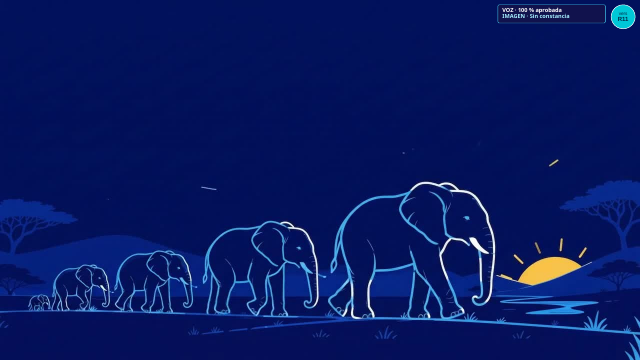

# Lámina 002 · ID PPT 285

## Trazabilidad

- XML de origen: `Sucesion_R11_Large_v10_Deduplicada_2026-11-17_0701_GT.xml` (versión 2; Flat OPC).
- SHA-256 del XML: `a31bc4260d3bf3c96678b66efd5bdf2fbc49dafac046904403b2f81e8c430f2d`.
- Procedencia de la miniatura: PNG extraído byte a byte del ZIP de 51 visibles.
- Procedencia de la locución: Cotejada con `Sucesion_R11_Large_v10_Locucion_2026-11-17_0701_GT.txt`.
- Posición física: **002**; orden visible: **002**; ID nativo: **285**.
- Archivo de imagen: `Sucesion_R11_Large_v10_Deduplicada_2026-11-17_0701_GT__002.png` (640 × 360).
- SHA-256 del PNG: `af6990e0f96051cb03b037e9ed979cdd544db0916e5afd12ae30aa14f3637fdf`.
- Estado: **visible**.

## Juicio de Sammy (no es veredicto de Randy)

- **Imagen:** Elefantes de contorno y sol amarillo sostienen la escena; el tercio superior queda vacío.
- **Locución:** Las dos manadas contrastan bien; la pregunta al líder merece una pausa.
- **Referencia alternativa:** [PNG activo](https://raw.githubusercontent.com/nkrikamo/RandyPublic/refs/heads/main/010_SucesionNextGenConnectors/BuenasReferenciasSucesion/Elefantes-juicio5-Aprobad%C3%ADsima.png) · La ilustración evaluada por Randy deja la manada y el recorrido sin rótulos técnicos.

## Voz en off

Imagina una manada de elefantes africanos atravesando la sabana.
Los más expertos del grupo son los que conocen las rutas y guían a los demás para evitar los peligros.
Los más jóvenes observan, aprenden y ganan experiencia junto a ellos. Con el tiempo, pueden asumir mayores responsabilidades.
Piensa en una decisión que hoy depende de ti. ¿Quién de tu equipo podría tomarla con buen criterio?
Ahora imagina una manada donde solo quien la guía sabe encontrar agua durante la sequía.
Los demás siguen sus pasos, pero no han aprendido a reconocer las señales del entorno ni a decidir cuándo cambiar de rumbo.
Si pierde a su líder, esta manada podría quedar en peligro.
Es por eso que los grandes líderes comparten lo que saben para fortalecer a la siguiente generación y prepararla para el futuro.
