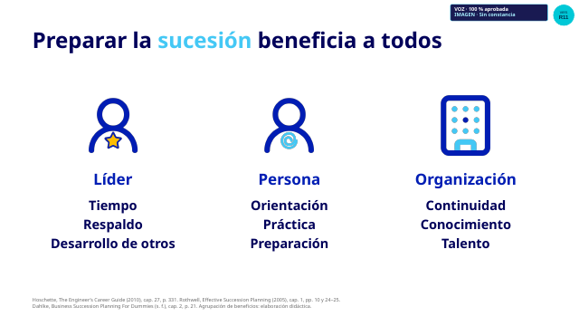

# Lámina 004 · ID PPT 287

## Trazabilidad

- XML de origen: `Sucesion_R11_Large_v10_Deduplicada_2026-11-17_0701_GT.xml` (versión 2; Flat OPC).
- SHA-256 del XML: `a31bc4260d3bf3c96678b66efd5bdf2fbc49dafac046904403b2f81e8c430f2d`.
- Procedencia de la miniatura: PNG extraído byte a byte del ZIP de 51 visibles.
- Procedencia de la locución: Cotejada con `Sucesion_R11_Large_v10_Locucion_2026-11-17_0701_GT.txt`.
- Posición física: **004**; orden visible: **004**; ID nativo: **287**.
- Archivo de imagen: `Sucesion_R11_Large_v10_Deduplicada_2026-11-17_0701_GT__004.png` (640 × 360).
- SHA-256 del PNG: `d072dd96c46ebc658864e2c9e43f809ebac2669ca455e4083fa12f5b8ba25725`.
- Estado: **visible**.

## Juicio de Sammy (no es veredicto de Randy)

- **Imagen:** Tres íconos y columnas legibles; los créditos al pie quedan diminutos.
- **Locución:** Distingue beneficios para líder, colaborador y organización; la primera frase concentra demasiadas ideas.
- **Referencia alternativa:** No encontré una alternativa mejor verificada.

## Voz en off

Preparar tu sucesión empieza con el desarrollo de otra persona. Cuando un colaborador aprende a resolver una responsabilidad que antes te consultaba, puedes dedicar más atención a las prioridades que necesitan tu experiencia. También cuentas con respaldo para asumir nuevos retos y puedes reconocer tu contribución en lo que otros aprendieron a hacer.
Para el colaborador, el proceso ofrece una referencia sobre qué necesita desarrollar, oportunidades de práctica con apoyo y evidencias de su preparación.
La organización resguarda conocimiento, fortalece la continuidad del trabajo y conoce mejor el talento con el que puede responder a nuevas necesidades.
