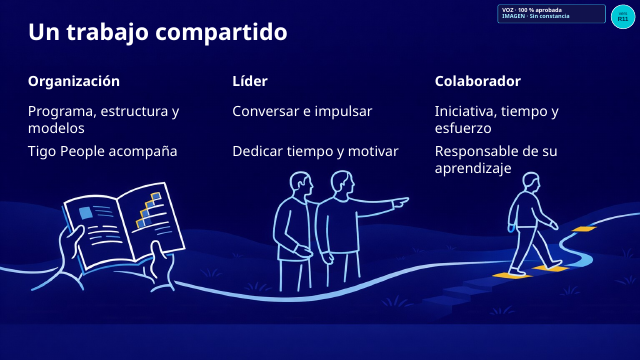

# Lámina 005 · ID PPT 288

## Trazabilidad

- XML de origen: `Sucesion_R11_Large_v10_Deduplicada_2026-11-17_0701_GT.xml` (versión 2; Flat OPC).
- SHA-256 del XML: `a31bc4260d3bf3c96678b66efd5bdf2fbc49dafac046904403b2f81e8c430f2d`.
- Procedencia de la miniatura: PNG extraído byte a byte del ZIP de 51 visibles.
- Procedencia de la locución: Cotejada con `Sucesion_R11_Large_v10_Locucion_2026-11-17_0701_GT.txt`.
- Posición física: **005**; orden visible: **005**; ID nativo: **288**.
- Archivo de imagen: `Sucesion_R11_Large_v10_Deduplicada_2026-11-17_0701_GT__005.png` (640 × 360).
- SHA-256 del PNG: `680329031a038d3594386b2dc980af927fe2620ddb6fe5aa6126a69ec6adff61`.
- Estado: **visible**.

## Juicio de Sammy (no es veredicto de Randy)

- **Imagen:** La línea enlaza tres roles; texto apretado y pesos de columnas desiguales.
- **Locución:** Distribuye responsabilidades; «fruto de la sinergia» suena abstracto y designar no debe sonar a anuncio.
- **Referencia alternativa:** No encontré una alternativa mejor verificada.

## Voz en off

Estos beneficios son el fruto de la sinergia entre los roles que debe asumir cada uno en el programa de Next Gen.
La organización pone este programa a tu disposición, con una estructura y modelos validados para orientar el desarrollo de tu sucesor, asesorándote en el camino.
Tú como líder emplearás tu experiencia y criterio para construir tu legado a través de este programa, dedicando tiempo a las conversaciones y planes, y motivando a tu sucesor a avanzar.
El colaborador que designes como sucesor será el principal responsable de su propio desarrollo. Le corresponde aceptar la iniciativa y comprometerse con su aprendizaje, sabiendo que requerirá dedicarle esfuerzo, tiempo y otros recursos.
Ese compromiso lo ayudará a estar preparado para aprovechar las oportunidades que puedan surgir.
