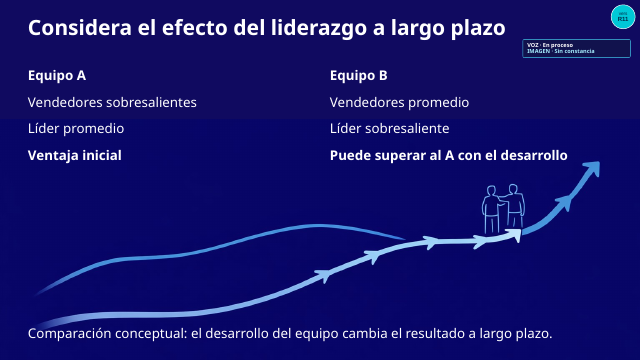

# Lámina 006 · ID PPT 289

## Trazabilidad

- XML de origen: `Sucesion_R11_Large_v10_Deduplicada_2026-11-17_0701_GT.xml` (versión 2; Flat OPC).
- SHA-256 del XML: `a31bc4260d3bf3c96678b66efd5bdf2fbc49dafac046904403b2f81e8c430f2d`.
- Procedencia de la miniatura: PNG extraído byte a byte del ZIP de 51 visibles.
- Procedencia de la locución: Cotejada con `Sucesion_R11_Large_v10_Locucion_2026-11-17_0701_GT.txt`.
- Posición física: **006**; orden visible: **006**; ID nativo: **289**.
- Archivo de imagen: `Sucesion_R11_Large_v10_Deduplicada_2026-11-17_0701_GT__006.png` (640 × 360).
- SHA-256 del PNG: `36678bd57db753f69c47d33b0fe00a40ae9d019f4c04a91d7f2e683fda0e8686`.
- Estado: **visible**.

## Juicio de Sammy (no es veredicto de Randy)

- **Imagen:** La comparación A/B se entiende, pero la curva puede parecer una proyección cuantitativa.
- **Locución:** Aporta el contraste de Zoltners y aclara que no predice resultados; puede condensarse.
- **Referencia alternativa:** No encontré una alternativa mejor verificada.

## Voz en off

Dedicar tiempo a desarrollar a tus colaboradores puede cambiar los resultados del equipo a largo plazo. Imagina dos equipos de ventas, como propone Andris Zoltners. El primero cuenta con vendedores sobresalientes y un líder de desempeño promedio. El segundo parte de vendedores promedio acompañados por un líder sobresaliente. El primero podría comenzar con ventaja; el segundo podría superarlo si sus integrantes desarrollan sus capacidades. Es una comparación conceptual, no una predicción de resultados. Al preparar tu sucesión, observa también si la persona puede ayudar a otros a aprender y sostener los resultados del equipo.
