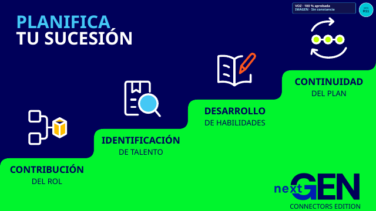

# Lámina 007 · ID PPT 290

## Trazabilidad

- XML de origen: `Sucesion_R11_Large_v10_Deduplicada_2026-11-17_0701_GT.xml` (versión 2; Flat OPC).
- SHA-256 del XML: `a31bc4260d3bf3c96678b66efd5bdf2fbc49dafac046904403b2f81e8c430f2d`.
- Procedencia de la miniatura: PNG extraído byte a byte del ZIP de 51 visibles.
- Procedencia de la locución: Cotejada con `Sucesion_R11_Large_v10_Locucion_2026-11-17_0701_GT.txt`.
- Posición física: **007**; orden visible: **007**; ID nativo: **290**.
- Archivo de imagen: `Sucesion_R11_Large_v10_Deduplicada_2026-11-17_0701_GT__007.png` (640 × 360).
- SHA-256 del PNG: `1bc7ba20c1b43f692fc8f88e4544f90688b6ab794bffa9574a83a79ca83c7ad4`.
- Estado: **visible**.

## Juicio de Sammy (no es veredicto de Randy)

- **Imagen:** La escalera organiza el recorrido; el verde neón domina y los rótulos bajos pierden contraste.
- **Locución:** Los cuatro pasos se distinguen; cuida que «en tu equipo» no se entienda como único ámbito.
- **Referencia alternativa:** [PNG activo](https://raw.githubusercontent.com/nkrikamo/RandyPublic/refs/heads/main/010_SucesionNextGenConnectors/BuenasReferenciasSucesion/EscaleraVerde-juicio5-Aprobad%C3%ADsima.png) · Conserva la progresión reconocida por Randy sin los rótulos de revisión de la copia.

## Voz en off

Te presentamos el programa NextGen. Consta de cuatro pasos que te ayudarán a planificar tu sucesión.
Comienza analizando las funciones de tu propio rol y actualiza el modelo de contribución al puesto que ya conoces.
Después, identifica en tu equipo al talento que podría prepararse para asumir ese rol, considerando interés y habilidades demostradas.
Analiza sus brechas y planifica experiencias que le permitan desarrollar esas habilidades necesarias.
Tu liderazgo también se refleja en cómo das continuidad al programa, acompañando el desarrollo y documentando la transformación profesional de tu sucesor.
