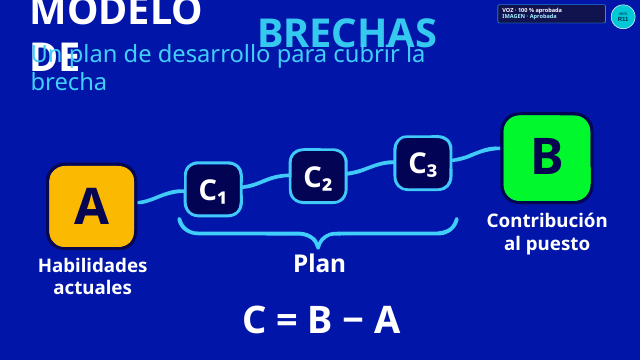

# Lámina 009 · ID PPT 292

## Trazabilidad

- XML de origen: `Sucesion_R11_Large_v10_Deduplicada_2026-11-17_0701_GT.xml` (versión 2; Flat OPC).
- SHA-256 del XML: `a31bc4260d3bf3c96678b66efd5bdf2fbc49dafac046904403b2f81e8c430f2d`.
- Procedencia de la miniatura: PNG extraído byte a byte del ZIP de 51 visibles.
- Procedencia de la locución: Cotejada con `Sucesion_R11_Large_v10_Locucion_2026-11-17_0701_GT.txt`.
- Posición física: **009**; orden visible: **009**; ID nativo: **292**.
- Archivo de imagen: `Sucesion_R11_Large_v10_Deduplicada_2026-11-17_0701_GT__009.png` (640 × 360).
- SHA-256 del PNG: `b2f11f71a78ec8acb3cb2ba70065f2a0b34893ec1c852ea6d1aae2ca2d1c5c6a`.
- Estado: **visible**.

## Juicio de Sammy (no es veredicto de Randy)

- **Imagen:** A–C–B y escalones son útiles, pero el título y subtítulo se solapan en el render.
- **Locución:** Define A, B y C con claridad; la transición final abre bien la explicación paso a paso.
- **Referencia alternativa:** [PNG activo](https://raw.githubusercontent.com/nkrikamo/RandyPublic/refs/heads/main/010_SucesionNextGenConnectors/UniversoDeSlides/004_E007_Modelo_de_brechas_Alternativa_editable/004_E007_Modelo_de_brechas_Alternativa_editable__001.png) · E007 editable conserva A–C1/C2/C3–B y la fórmula; corrige el solapamiento del encabezado, aumenta espacio y mejora contraste.

## Voz en off

El modelo de brechas te ayuda a conectar el punto de partida de tu sucesor con la contribución que requerirá ocupar tu puesto. Llamaremos A a lo que sabe hacer hoy y a lo que ha demostrado en su puesto actual. B es el conjunto de habilidades que requerirá para las funciones y responsabilidades de tu puesto.
La diferencia entre B y A es C: la brecha de desarrollo. Para cubrirla, acordarás con tu sucesor un plan con acciones de aprendizaje, práctica y exposición a nuevas situaciones de liderazgo. Veamos cómo armar este plan paso a paso.
