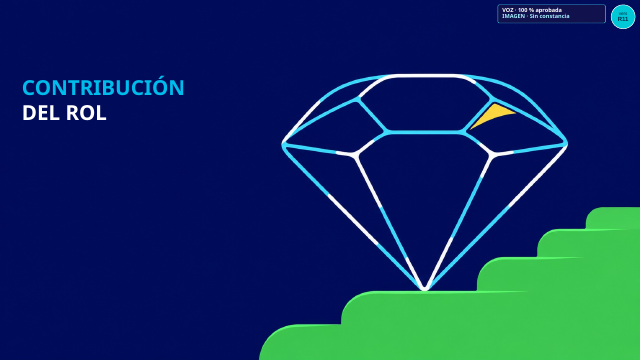

# Lámina 010 · ID PPT 293

## Trazabilidad

- XML de origen: `Sucesion_R11_Large_v10_Deduplicada_2026-11-17_0701_GT.xml` (versión 2; Flat OPC).
- SHA-256 del XML: `a31bc4260d3bf3c96678b66efd5bdf2fbc49dafac046904403b2f81e8c430f2d`.
- Procedencia de la miniatura: PNG extraído byte a byte del ZIP de 51 visibles.
- Procedencia de la locución: Cotejada con `Sucesion_R11_Large_v10_Locucion_2026-11-17_0701_GT.txt`.
- Posición física: **010**; orden visible: **010**; ID nativo: **293**.
- Archivo de imagen: `Sucesion_R11_Large_v10_Deduplicada_2026-11-17_0701_GT__010.png` (640 × 360).
- SHA-256 del PNG: `126341e3fce1d09187f30319cb48683317eccd32428f4467ff427a3834e106e2`.
- Estado: **visible**.

## Juicio de Sammy (no es veredicto de Randy)

- **Imagen:** Diamante grande y reconocible; la escalera verde compite con él.
- **Locución:** Puente de una frase, funcional como separador.
- **Referencia alternativa:** No encontré una alternativa mejor verificada.

## Voz en off

Veamos con detalle el primer paso: contribución de tu rol.
