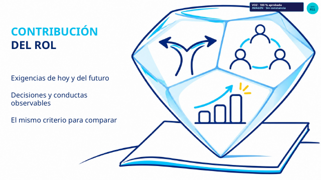

# Lámina 011 · ID PPT 294

## Trazabilidad

- XML de origen: `Sucesion_R11_Large_v10_Deduplicada_2026-11-17_0701_GT.xml` (versión 2; Flat OPC).
- SHA-256 del XML: `a31bc4260d3bf3c96678b66efd5bdf2fbc49dafac046904403b2f81e8c430f2d`.
- Procedencia de la miniatura: PNG extraído byte a byte del ZIP de 51 visibles.
- Procedencia de la locución: Cotejada con `Sucesion_R11_Large_v10_Locucion_2026-11-17_0701_GT.txt`.
- Posición física: **011**; orden visible: **011**; ID nativo: **294**.
- Archivo de imagen: `Sucesion_R11_Large_v10_Deduplicada_2026-11-17_0701_GT__011.png` (640 × 360).
- SHA-256 del PNG: `0dec2472f4997e8d3b17fb62dd3063e63a5b28e5ffda4e89f0d3f0d864112494`.
- Estado: **visible**.

## Juicio de Sammy (no es veredicto de Randy)

- **Imagen:** Fondo blanco respira y el diamante orienta; la figura absorbe más espacio que los criterios.
- **Locución:** Aterriza el formato en decisiones, cultura y relaciones; conviene agrupar la enumeración.
- **Referencia alternativa:** No encontré una alternativa mejor verificada.

## Voz en off

En módulos anteriores de Soy Líder Tigo definimos nuestro modelo de contribución al puesto y lo trabajaste para los integrantes de tu equipo, analizando sus funciones y requisitos. En esta ocasión deberás revisar el formato de tu propio rol, acordándolo con tu líder inmediato.
Redacta cómo se define tu aporte diario a la compañía y qué decisiones debes tomar en tu liderazgo. Muestra cómo se refleja en las acciones que tomas y en los resultados. Identifica las responsabilidades críticas, las áreas con las que se debe interactuar o las personas importantes con las que alguien de tu puesto debería relacionarse. La cultura también se refleja en cómo das reconocimiento o resuelves desacuerdos, así como en el trato a clientes internos o externos y la memoria histórica que te permite anticipar soluciones.
