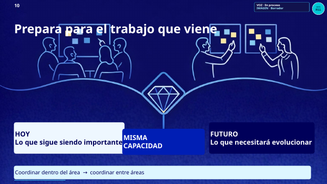

# Lámina 013 · ID PPT 296

## Trazabilidad

- XML de origen: `Sucesion_R11_Large_v10_Deduplicada_2026-11-17_0701_GT.xml` (versión 2; Flat OPC).
- SHA-256 del XML: `a31bc4260d3bf3c96678b66efd5bdf2fbc49dafac046904403b2f81e8c430f2d`.
- Procedencia de la miniatura: PNG extraído byte a byte del ZIP de 51 visibles.
- Procedencia de la locución: Cotejada con `Sucesion_R11_Large_v10_Locucion_2026-11-17_0701_GT.txt`.
- Posición física: **013**; orden visible: **012**; ID nativo: **296**.
- Archivo de imagen: `Sucesion_R11_Large_v10_Deduplicada_2026-11-17_0701_GT__013.png` (640 × 360).
- SHA-256 del PNG: `c8755a8380721ee4c02f0c60104f59828d76e2aa487c07f6e0ba6a8253c2e9ef`.
- Estado: **visible**.

## Juicio de Sammy (no es veredicto de Randy)

- **Imagen:** Hoy/Futuro y el ejemplo inferior vuelven concreto el contraste; arriba se pisan título e ilustración.
- **Locución:** Aporta una comparación verificable: coordinar dentro del área frente a coordinar entre áreas.
- **Referencia alternativa:** No encontré una alternativa mejor verificada.

## Voz en off

El puesto también puede cambiar. Una tecnología nueva, una necesidad del cliente o una prioridad del negocio pueden modificar las decisiones que exigirá. Al actualizar tu formato de contribución, consulta a las áreas relacionadas y a la estrategia. Distingue lo que ya es una exigencia de lo que todavía es una posibilidad. Compara hoy y futuro sobre la misma capacidad: por ejemplo, coordinar entregas dentro del área y después coordinar entre áreas. Describe qué decisiones y conductas harían visible ese cambio. El colaborador podrá aportar con un estilo distinto al tuyo. Si una responsabilidad cambia, actualiza el perfil y registra el motivo.
