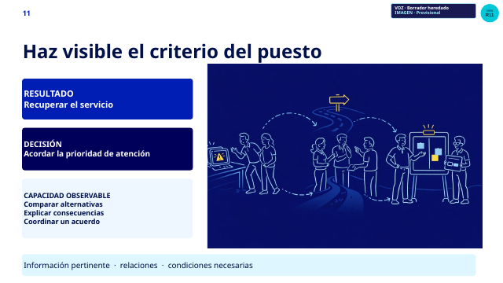

# Lámina 015 · ID PPT 297

## Trazabilidad

- XML de origen: `Sucesion_R11_Large_v10_Deduplicada_2026-11-17_0701_GT.xml` (versión 2; Flat OPC).
- SHA-256 del XML: `a31bc4260d3bf3c96678b66efd5bdf2fbc49dafac046904403b2f81e8c430f2d`.
- Procedencia de la miniatura: PNG extraído byte a byte del ZIP de 51 visibles.
- Procedencia de la locución: Cotejada con `Sucesion_R11_Large_v10_Locucion_2026-11-17_0701_GT.txt`.
- Posición física: **015**; orden visible: **014**; ID nativo: **297**.
- Archivo de imagen: `Sucesion_R11_Large_v10_Deduplicada_2026-11-17_0701_GT__015.png` (640 × 360).
- SHA-256 del PNG: `b78c00a07c7972c40c85927685ea8fbd2d057b73deba4edce8a04b5a67eeb4a0`.
- Estado: **visible**.

## Juicio de Sammy (no es veredicto de Randy)

- **Imagen:** Tres niveles de criterio y ejemplo útil; bloques pequeños y gráfica oscura demasiado dominante.
- **Locución:** Muy aplicable: resultado, decisión y conducta. La prueba de que otra área pueda usar el criterio aclara el cierre.
- **Referencia alternativa:** No encontré una alternativa mejor verificada.

## Voz en off

Comprueba que el formato permita reconocer tres cosas: el resultado del puesto, las decisiones necesarias y las capacidades observables. En operaciones, el resultado podría ser recuperar el servicio; una decisión, acordar prioridades de atención. Para observar la capacidad, busca cómo alguien compara alternativas, explica consecuencias y coordina un acuerdo. Precisa también límites de autoridad, información y relaciones necesarias. Si una persona de otra área puede entender qué habría que observar, el criterio está suficientemente claro para pasar a identificar talento. El formato describe el trabajo, no una copia de tu manera de liderar.
