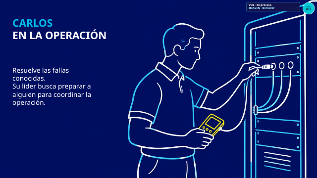

# Lámina 017 · ID PPT 298

## Trazabilidad

- XML de origen: `Sucesion_R11_Large_v10_Deduplicada_2026-11-17_0701_GT.xml` (versión 2; Flat OPC).
- SHA-256 del XML: `a31bc4260d3bf3c96678b66efd5bdf2fbc49dafac046904403b2f81e8c430f2d`.
- Procedencia de la miniatura: Exportada desde una copia con las láminas ocultas incluidas; el XML fuente no se alteró.
- Procedencia de la locución: Notas del XML; esta lámina no estaba en el TXT de las visibles.
- Posición física: **017**; ID nativo: **298**.
- Archivo de imagen: `Sucesion_R11_Large_v10_Deduplicada_2026-11-17_0701_GT__017.png` (640 × 360).
- SHA-256 del PNG: `23fecc5e916bbf64b65aa1a37dc96cc23cf8b624908332022c702ab98fef1c54`.
- Estado: **oculta en el XML; marcado para eliminar**.

## Juicio de Sammy (no es veredicto de Randy)

- **Imagen:** 4/5 · El contorno único de Carlos y el rack da una escena específica, con el medidor amarillo como foco; el equipo recortado domina el lado derecho.
- **Locución:** El texto introduce bien la pericia actual, pero dejaría una idea puente explícita hacia coordinar a otros.
- **Referencia alternativa:** [Lámina 018](../018/Sucesion_R11_Large_v10_Deduplicada_2026-11-17_0701_GT__018.png) · La versión visible presenta directamente el contraste del puesto.

## Voz en off

*Sin locución publicable separada con certeza de las notas editoriales, o sin notas en el XML.*
