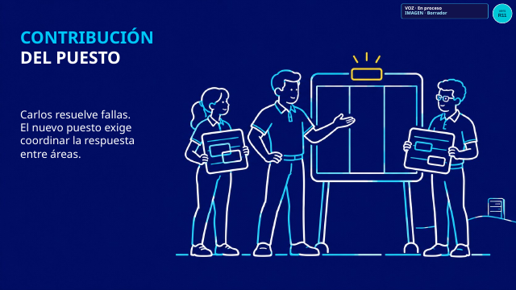

# Lámina 018 · ID PPT 299

## Trazabilidad

- XML de origen: `Sucesion_R11_Large_v10_Deduplicada_2026-11-17_0701_GT.xml` (versión 2; Flat OPC).
- SHA-256 del XML: `a31bc4260d3bf3c96678b66efd5bdf2fbc49dafac046904403b2f81e8c430f2d`.
- Procedencia de la miniatura: PNG extraído byte a byte del ZIP de 51 visibles.
- Procedencia de la locución: Cotejada con `Sucesion_R11_Large_v10_Locucion_2026-11-17_0701_GT.txt`.
- Posición física: **018**; orden visible: **015**; ID nativo: **299**.
- Archivo de imagen: `Sucesion_R11_Large_v10_Deduplicada_2026-11-17_0701_GT__018.png` (640 × 360).
- SHA-256 del PNG: `d18f007d7c7e2ec3e9b1ea828b8769135bd22019a5198ee95ee90a327695efba`.
- Estado: **visible**.

## Juicio de Sammy (no es veredicto de Randy)

- **Imagen:** Ilustración de coordinación legible, pero el azul cede espacio a una explicación demasiado breve.
- **Locución:** El caso distingue técnica de coordinación transversal; no recuperar esta trama sobre los casos elegidos en R13.
- **Referencia alternativa:** No encontré una alternativa mejor verificada.

## Voz en off

Carlos es la persona a quien todos llaman cuando aparece una falla conocida. Domina los procedimientos y suele resolver rápido.
Su líder necesita preparar una alternativa para coordinar la operación. Primero define la contribución del puesto: priorizar incidencias, organizar la respuesta entre red, soporte y atención al cliente, mantener informadas a las personas afectadas y sostener el servicio mientras se resuelve el problema.
Para comparar la misma capacidad, la coordinación, observa dos niveles. Hoy Carlos coordina entregas dentro de su área. El puesto futuro exige coordinar la respuesta entre varias áreas.
Una incidencia nueva trae información contradictoria de dos áreas. Carlos sabe revisar la parte técnica, pero todavía falta observar cómo organiza una respuesta conjunta. Mejorar el indicador de un área trasladando el problema a otra no resuelve la necesidad del negocio.
Su líder aún no elige un sucesor. Define qué decisiones y resultados necesitará observar para comprobar esa capacidad.
¿Quién puede aprender a responder por la operación completa, no solo por una falla?
