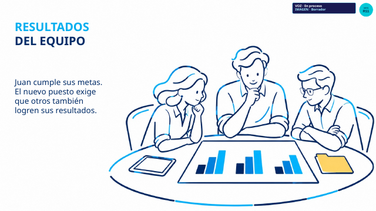

# Lámina 020 · ID PPT 301

## Trazabilidad

- XML de origen: `Sucesion_R11_Large_v10_Deduplicada_2026-11-17_0701_GT.xml` (versión 2; Flat OPC).
- SHA-256 del XML: `a31bc4260d3bf3c96678b66efd5bdf2fbc49dafac046904403b2f81e8c430f2d`.
- Procedencia de la miniatura: PNG extraído byte a byte del ZIP de 51 visibles.
- Procedencia de la locución: Cotejada con `Sucesion_R11_Large_v10_Locucion_2026-11-17_0701_GT.txt`.
- Posición física: **020**; orden visible: **016**; ID nativo: **301**.
- Archivo de imagen: `Sucesion_R11_Large_v10_Deduplicada_2026-11-17_0701_GT__020.png` (640 × 360).
- SHA-256 del PNG: `22230aadd87f2a8e84f704ff409d423ea6fa238e529756ae3251a9217c5e47ad`.
- Estado: **visible**.

## Juicio de Sammy (no es veredicto de Randy)

- **Imagen:** Escena blanca clara, con buen uso del amarillo; copiar más texto reduciría el aire.
- **Locución:** Define la diferencia entre vender bien y desarrollar a un equipo; útil como regla, no como caso sustituido.
- **Referencia alternativa:** No encontré una alternativa mejor verificada.

## Voz en off

Juan conoce a sus clientes y cumple sus metas. Por eso, cuando su jefe piensa en una posible sucesión, su nombre aparece. Pero el puesto futuro exige orientar a otros vendedores, analizar los indicadores del conjunto, definir metas y darles seguimiento. El resultado esperado depende del equipo, no solamente de las ventas de Juan. Antes de considerarlo preparado, el jefe necesita observar cómo ayuda a otros a mejorar, qué decisiones toma y cómo sostiene los resultados del conjunto. Esta diferencia precisa lo que Juan tendría que aprender.
