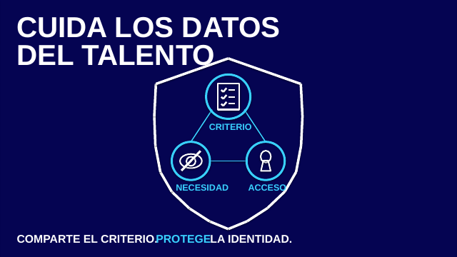

# Lámina 021 · ID PPT 256

## Trazabilidad

- XML de origen: `Sucesion_R11_Large_v10_Deduplicada_2026-11-17_0701_GT.xml` (versión 2; Flat OPC).
- SHA-256 del XML: `a31bc4260d3bf3c96678b66efd5bdf2fbc49dafac046904403b2f81e8c430f2d`.
- Procedencia de la miniatura: PNG extraído byte a byte del ZIP de 51 visibles.
- Procedencia de la locución: Cotejada con `Sucesion_R11_Large_v10_Locucion_2026-11-17_0701_GT.txt`.
- Posición física: **021**; orden visible: **017**; ID nativo: **256**.
- Archivo de imagen: `Sucesion_R11_Large_v10_Deduplicada_2026-11-17_0701_GT__021.png` (640 × 360).
- SHA-256 del PNG: `b24e01f1bac918ddbaf2c629fa039491aa00c7a7306997f2fc7a3c8238d315a6`.
- Estado: **visible**.

## Juicio de Sammy (no es veredicto de Randy)

- **Imagen:** Escudo e iconos hacen visible la idea; el gran titular y pie pegado necesitan más aire.
- **Locución:** Clave: compartir criterios sin divulgar identidades ni aspiraciones; formulación breve y utilizable.
- **Referencia alternativa:** No encontré una alternativa mejor verificada.

## Voz en off

Al identificar talento, comparte los criterios que orientan el desarrollo y protege las valoraciones individuales. Consulta únicamente información laboral pertinente, con una necesidad clara y por los canales autorizados. Las aspiraciones que una persona te confía en una conversación de carrera requieren reserva. Explicar el proceso no significa divulgar quién está siendo considerado.
