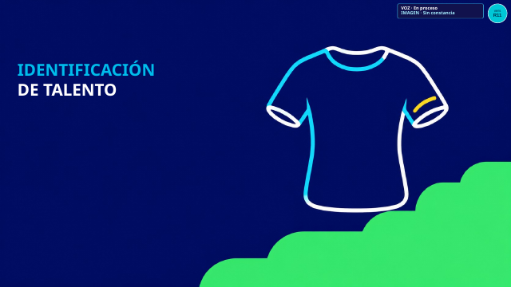

# Lámina 022 · ID PPT 302

## Trazabilidad

- XML de origen: `Sucesion_R11_Large_v10_Deduplicada_2026-11-17_0701_GT.xml` (versión 2; Flat OPC).
- SHA-256 del XML: `a31bc4260d3bf3c96678b66efd5bdf2fbc49dafac046904403b2f81e8c430f2d`.
- Procedencia de la miniatura: PNG extraído byte a byte del ZIP de 51 visibles.
- Procedencia de la locución: Cotejada con `Sucesion_R11_Large_v10_Locucion_2026-11-17_0701_GT.txt`.
- Posición física: **022**; orden visible: **018**; ID nativo: **302**.
- Archivo de imagen: `Sucesion_R11_Large_v10_Deduplicada_2026-11-17_0701_GT__022.png` (640 × 360).
- SHA-256 del PNG: `77004102e1eb6adc0187b86fd3e6d84edf6223d72bb578d6494d18f452b32160`.
- Estado: **visible**.

## Juicio de Sammy (no es veredicto de Randy)

- **Imagen:** Playera y escalera marcan la fase; el símbolo por sí solo no dice qué se observará.
- **Locución:** Puente breve; menciona evidencia y conversación sin adelantar el contenido.
- **Referencia alternativa:** No encontré una alternativa mejor verificada.

## Voz en off

Pasemos al segundo paso: identificar talento con evidencias y conversación.
