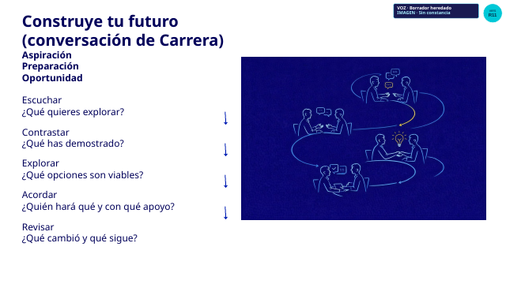

# Lámina 025 · ID PPT 305

## Trazabilidad

- XML de origen: `Sucesion_R11_Large_v10_Deduplicada_2026-11-17_0701_GT.xml` (versión 2; Flat OPC).
- SHA-256 del XML: `a31bc4260d3bf3c96678b66efd5bdf2fbc49dafac046904403b2f81e8c430f2d`.
- Procedencia de la miniatura: PNG extraído byte a byte del ZIP de 51 visibles.
- Procedencia de la locución: Cotejada con `Sucesion_R11_Large_v10_Locucion_2026-11-17_0701_GT.txt`.
- Posición física: **025**; orden visible: **021**; ID nativo: **305**.
- Archivo de imagen: `Sucesion_R11_Large_v10_Deduplicada_2026-11-17_0701_GT__025.png` (640 × 360).
- SHA-256 del PNG: `53fe1939564aa589846ce7a75d3886f50dda7dd69941e1e827114585b9edd381`.
- Estado: **visible**.

## Juicio de Sammy (no es veredicto de Randy)

- **Imagen:** La secuencia en columna es escaneable; el recuadro azul casi negro pierde los dibujos.
- **Locución:** El diálogo muestra interés, apoyo y límite real; rescatar preguntas, no reponer el caso antiguo.
- **Referencia alternativa:** No encontré una alternativa mejor verificada.

## Voz en off

Imagina una conversación de carrera entre el líder y Carlos. El líder conoce su dominio técnico, pero quiere escuchar qué responsabilidad le interesa explorar.
Líder: Carlos, ¿qué te gustaría empezar a hacer?
Carlos: Me interesa coordinar proyectos con otras áreas. He preparado información, pero las prioridades suele decidirlas alguien más.
Líder: ¿Qué necesitarías para probar esa responsabilidad?
Carlos: Entender qué puedo decidir, observar cómo manejas un desacuerdo y contar con tiempo para una mejora pequeña.
Líder: Revisaré tu carga y el apoyo de las áreas. Primero observas; después preparas opciones y conduces un acuerdo dentro de los límites autorizados. Revisaremos lo que logres y qué apoyo necesites.
La conversación deja un interés expresado, una práctica posible y compromisos para ambas partes. Todavía no demuestra que Carlos esté preparado para asumir todo el puesto.
