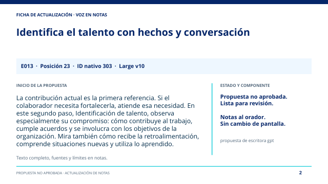

# Lámina 026 · ID PPT 353

## Trazabilidad

- XML de origen: `Sucesion_R11_Large_v10_Deduplicada_2026-11-17_0701_GT.xml` (versión 2; Flat OPC).
- SHA-256 del XML: `a31bc4260d3bf3c96678b66efd5bdf2fbc49dafac046904403b2f81e8c430f2d`.
- Procedencia de la miniatura: Exportada desde una copia con las láminas ocultas incluidas; el XML fuente no se alteró.
- Procedencia de la locución: Notas del XML; esta lámina no estaba en el TXT de las visibles.
- Posición física: **026**; ID nativo: **353**.
- Archivo de imagen: `Sucesion_R11_Large_v10_Deduplicada_2026-11-17_0701_GT__026.png` (640 × 360).
- SHA-256 del PNG: `53987113ec8a92a0531160dda56d7a32d66309af02c9c05c752dd460b6baa443`.
- Estado: **oculta en el XML; marcado para eliminar**.

## Juicio de Sammy (no es veredicto de Randy)

- **Imagen:** 1/5 · Es una ficha administrativa: franja de metadatos, un bloque de párrafo y un panel de estado sin mnemónico.
- **Locución:** Hay una propuesta editorial en pantalla; no reutilizarla como voz aprobada.
- **Referencia alternativa:** [Lámina 023](../023/Sucesion_R11_Large_v10_Deduplicada_2026-11-17_0701_GT__023.png) · Es la pieza pedagógica visible que la ficha identifica por posición e ID.

## Voz en off

*Texto de las notas de una lámina oculta. No equivale a voz final aprobada.*

La contribución actual es la primera referencia. Si el colaborador necesita fortalecerla, atiende esa necesidad. En este segundo paso, Identificación de talento, observa especialmente su compromiso: cómo contribuye al trabajo, cumple acuerdos y se involucra con los objetivos de la organización. Mira también cómo recibe la retroalimentación, comprende situaciones nuevas y utiliza lo aprendido.

Distingue qué te permite conocer cada evidencia. El desempeño describe lo que logra hoy. El potencial se reconoce en señales de aprendizaje ante responsabilidades nuevas o más complejas. El interés expresa la trayectoria que quiere explorar. Para valorar su preparación, necesitas comprobar qué decisiones del puesto futuro ya puede sostener. Una experiencia puede aportar información a varias de estas preguntas, pero no responde por sí sola a todas.

Conversa sobre el trabajo que le gustaría explorar. Si su proyecto profesional va en otra dirección, revisa qué alternativa puede atender la necesidad de sucesión. Antes de comprometer un plan, deja claro qué sabes y qué te falta conocer.

Pídele que te cuente una contribución concreta: cuál era el problema, qué decidió, qué apoyo necesitó y qué aprendió. Contrasta su explicación con decisiones y resultados, una muestra de trabajo o las observaciones de quienes estuvieron presentes, por los canales autorizados.

Considera el contexto. Coordinar un equipo autónomo exige algo distinto de ayudar a uno que está aprendiendo a colaborar. Si hubo desacuerdos, observa cómo los comprendió y qué hizo para resolverlos. Si el puesto exige desarrollar a otros, busca un ejemplo de alguien que haya podido decidir mejor con su acompañamiento. En ventas, cumplir las metas muestra su contribución como vendedor; para valorar su preparación como líder, observa cómo acuerda prioridades, motiva al equipo y acompaña el aprendizaje.

Revisa también tus primeras impresiones. La afinidad, la visibilidad o un estilo parecido al tuyo pueden influir en tu preferencia. Pregúntate qué hechos sostienen tu valoración y qué información podría cambiarla. Tigo People puede ayudarte a revisar los criterios y posibles sesgos.

Distingue una habilidad demostrada, una dificultad observada y algo que todavía no ha tenido oportunidad de demostrar. Si falta una experiencia comparable, conserva la pregunta abierta y acuerda una oportunidad para observarla.

Usa información laboral pertinente, contextualizada y autorizada para este propósito. Mantén en reserva las evaluaciones individuales y las aspiraciones que te comparta. Puedes explicar al equipo cómo se desarrolla el talento sin divulgar valoraciones personales.

Con lo que sabes, decide qué experiencia ofrecer y qué necesitas comprobar. Actualiza tu valoración cuando aparezcan hechos nuevos o cambie el rol. Cada valoración corresponde a unas responsabilidades y a un momento de desarrollo; el siguiente paso debe seguir siendo útil para el colaborador.
