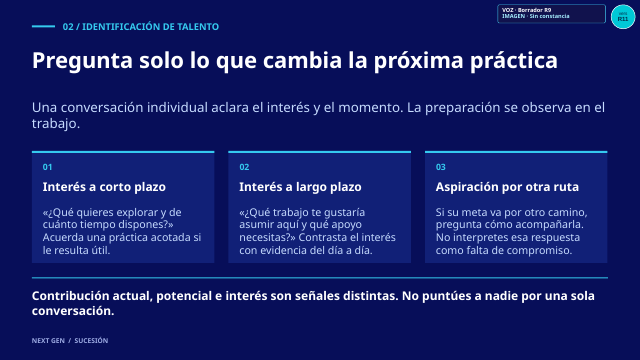

# Lámina 027 · ID PPT 329

## Trazabilidad

- XML de origen: `Sucesion_R11_Large_v10_Deduplicada_2026-11-17_0701_GT.xml` (versión 2; Flat OPC).
- SHA-256 del XML: `a31bc4260d3bf3c96678b66efd5bdf2fbc49dafac046904403b2f81e8c430f2d`.
- Procedencia de la miniatura: PNG extraído byte a byte del ZIP de 51 visibles.
- Procedencia de la locución: Cotejada con `Sucesion_R11_Large_v10_Locucion_2026-11-17_0701_GT.txt`.
- Posición física: **027**; orden visible: **022**; ID nativo: **329**.
- Archivo de imagen: `Sucesion_R11_Large_v10_Deduplicada_2026-11-17_0701_GT__027.png` (640 × 360).
- SHA-256 del PNG: `d1765eba6339c098251fb3a911d0d9be2e80ed175606c5a8e70a4b82500c1e68`.
- Estado: **visible**.

## Juicio de Sammy (no es veredicto de Randy)

- **Imagen:** Tres tarjetas ordenan opciones, pero párrafos y pie quedan muy pequeños.
- **Locución:** Preguntar por corto y largo plazo mejora la práctica; reserva de aspiraciones bien marcada.
- **Referencia alternativa:** No encontré una alternativa mejor verificada.

## Voz en off

Una conversación individual te ayuda a conocer el interés y el momento de desarrollo de cada colaborador. Pregunta qué quiere explorar ahora, qué trabajo le gustaría asumir más adelante y qué apoyo necesita. Si su aspiración está en otra especialidad o trayectoria, puedes acompañarla sin interpretar esa preferencia como falta de compromiso. La preparación se observa en el trabajo; el interés se conoce escuchando. Mantén en reserva las aspiraciones personales y decide qué experiencia sería útil para la persona y para la necesidad del rol.
