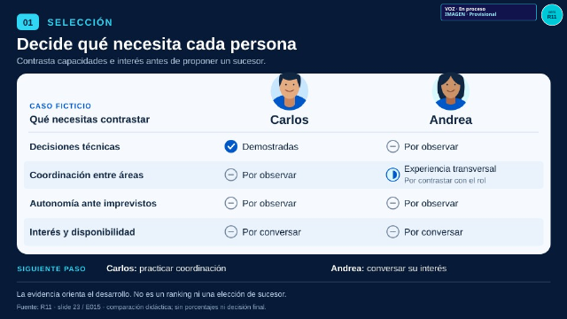

# Lámina 030 · ID PPT 330

## Trazabilidad

- XML de origen: `Sucesion_R11_Large_v10_Deduplicada_2026-11-17_0701_GT.xml` (versión 2; Flat OPC).
- SHA-256 del XML: `a31bc4260d3bf3c96678b66efd5bdf2fbc49dafac046904403b2f81e8c430f2d`.
- Procedencia de la miniatura: PNG extraído byte a byte del ZIP de 51 visibles.
- Procedencia de la locución: Cotejada con `Sucesion_R11_Large_v10_Locucion_2026-11-17_0701_GT.txt`.
- Posición física: **030**; orden visible: **023**; ID nativo: **330**.
- Archivo de imagen: `Sucesion_R11_Large_v10_Deduplicada_2026-11-17_0701_GT__030.png` (640 × 360).
- SHA-256 del PNG: `6a7f2889cc388d695be062b630f0a20e032c744696252199c2d196c775e0662f`.
- Estado: **visible**.

## Juicio de Sammy (no es veredicto de Randy)

- **Imagen:** Tabla comparativa clara a tamaño completo; celdas y fotos pequeñas en la vista de 640 px.
- **Locución:** Usa el mismo criterio y no fuerza la selección; no reintroducir conclusiones de Carlos y Andrea del borrador.
- **Referencia alternativa:** No encontré una alternativa mejor verificada.

## Voz en off

Compara a Carlos y Andrea con las mismas exigencias del puesto. Carlos demuestra solvencia técnica, pero su coordinación entre áreas y su autonomía ante imprevistos están por observar. Andrea aporta experiencia transversal; aún debes contrastar su alcance y conversar sobre su interés. No conviertas la experiencia de ninguno en una conclusión automática sobre preparación. Para Carlos puede ser útil una práctica de coordinación. Con Andrea, primero aclara qué responsabilidad desea explorar. Si alguna persona no está interesada, actualiza las alternativas sin descalificar su trayectoria. Conserva una cobertura temporal y una fecha para revisar la evidencia pendiente.
