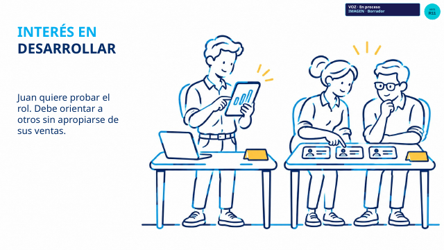

# Lámina 031 · ID PPT 308

## Trazabilidad

- XML de origen: `Sucesion_R11_Large_v10_Deduplicada_2026-11-17_0701_GT.xml` (versión 2; Flat OPC).
- SHA-256 del XML: `a31bc4260d3bf3c96678b66efd5bdf2fbc49dafac046904403b2f81e8c430f2d`.
- Procedencia de la miniatura: PNG extraído byte a byte del ZIP de 51 visibles.
- Procedencia de la locución: Cotejada con `Sucesion_R11_Large_v10_Locucion_2026-11-17_0701_GT.txt`.
- Posición física: **031**; orden visible: **024**; ID nativo: **308**.
- Archivo de imagen: `Sucesion_R11_Large_v10_Deduplicada_2026-11-17_0701_GT__031.png` (640 × 360).
- SHA-256 del PNG: `6dfa936b066708533e95d6d3ed23d1625c86dd17dc414e1fb75908fa71582381`.
- Estado: **visible**.

## Juicio de Sammy (no es veredicto de Randy)

- **Imagen:** Ilustración blanca legible y bien separada del texto; los detalles de la escena requieren verla de cerca.
- **Locución:** Distingue orientar de apropiarse del cierre; el ejemplo complementa, pero no reemplaza el caso vigente.
- **Referencia alternativa:** No encontré una alternativa mejor verificada.

## Voz en off

En ventas, Juan quiere explorar el liderazgo, pero reconoce que suele intervenir cuando otro vendedor tiene dificultades para cerrar. Su jefe necesita observar si puede orientar sin apropiarse del trabajo. En el encuentro individual compara su interés y evidencia con las mismas exigencias que utiliza para otros perfiles. No decide por antigüedad, afinidad o ranking. La siguiente experiencia buscará comprobar si Juan ayuda a que otro vendedor mejore por sí mismo.
