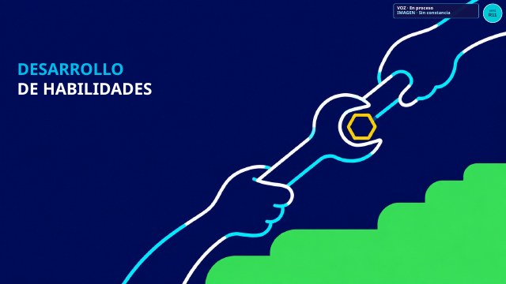

# Lámina 032 · ID PPT 309

## Trazabilidad

- XML de origen: `Sucesion_R11_Large_v10_Deduplicada_2026-11-17_0701_GT.xml` (versión 2; Flat OPC).
- SHA-256 del XML: `a31bc4260d3bf3c96678b66efd5bdf2fbc49dafac046904403b2f81e8c430f2d`.
- Procedencia de la miniatura: PNG extraído byte a byte del ZIP de 51 visibles.
- Procedencia de la locución: Cotejada con `Sucesion_R11_Large_v10_Locucion_2026-11-17_0701_GT.txt`.
- Posición física: **032**; orden visible: **025**; ID nativo: **309**.
- Archivo de imagen: `Sucesion_R11_Large_v10_Deduplicada_2026-11-17_0701_GT__032.png` (640 × 360).
- SHA-256 del PNG: `41d2226e9df4ee911c74e3a00535635cd77c42b1ba5f5b7b0faf5bb11fb60766`.
- Estado: **visible**.

## Juicio de Sammy (no es veredicto de Randy)

- **Imagen:** La llave compartida refuerza práctica con respaldo; verde fuerte reduce la jerarquía.
- **Locución:** Puente corto y preciso: brecha o evidencia pendiente se vuelve práctica observable.
- **Referencia alternativa:** No encontré una alternativa mejor verificada.

## Voz en off

El tercer paso es desarrollo de habilidades: convertir una brecha o evidencia pendiente en una práctica observable.
