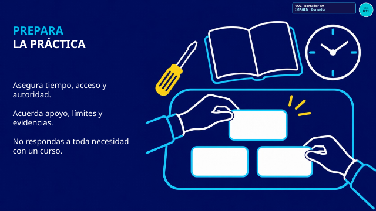

# Lámina 034 · ID PPT 311

## Trazabilidad

- XML de origen: `Sucesion_R11_Large_v10_Deduplicada_2026-11-17_0701_GT.xml` (versión 2; Flat OPC).
- SHA-256 del XML: `a31bc4260d3bf3c96678b66efd5bdf2fbc49dafac046904403b2f81e8c430f2d`.
- Procedencia de la miniatura: PNG extraído byte a byte del ZIP de 51 visibles.
- Procedencia de la locución: Cotejada con `Sucesion_R11_Large_v10_Locucion_2026-11-17_0701_GT.txt`.
- Posición física: **034**; orden visible: **026**; ID nativo: **311**.
- Archivo de imagen: `Sucesion_R11_Large_v10_Deduplicada_2026-11-17_0701_GT__034.png` (640 × 360).
- SHA-256 del PNG: `fd3327b86c517e71c7c3e41eaa53362003dd718cc90fbd32581983ea21d73f83`.
- Estado: **visible**.

## Juicio de Sammy (no es veredicto de Randy)

- **Imagen:** La metáfora de herramientas y bloques dinamiza la página; los bloques blancos vacíos parecen un error.
- **Locución:** Explica diagnosticar la causa y acordar condiciones, apoyo y evidencias; gana si se divide oralmente.
- **Referencia alternativa:** No encontré una alternativa mejor verificada.

## Voz en off

Elige una capacidad prioritaria y describe qué hará el colaborador para demostrarla. En Carlos, la técnica está respaldada por resultados; la coordinación entre áreas necesita práctica y observación. Antes de encargarla, aclara si la dificultad proviene de falta de conocimiento, experiencia, información o autorización. Después acuerda tiempo, acceso, límites de decisión, personas de apoyo y evidencia que revisarán. Una mejora acotada puede servir para practicar decisiones sin asumir todo el puesto. Un curso aporta conocimiento cuando hace falta; coordinar, negociar o desarrollar a otros exige aplicar criterio en el trabajo y recibir retroalimentación. Deja en el PDI una responsabilidad concreta y una fecha de revisión.
