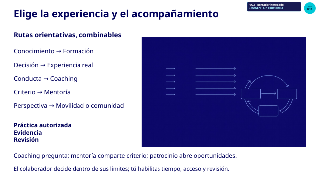

# Lámina 035 · ID PPT 312

## Trazabilidad

- XML de origen: `Sucesion_R11_Large_v10_Deduplicada_2026-11-17_0701_GT.xml` (versión 2; Flat OPC).
- SHA-256 del XML: `a31bc4260d3bf3c96678b66efd5bdf2fbc49dafac046904403b2f81e8c430f2d`.
- Procedencia de la miniatura: PNG extraído byte a byte del ZIP de 51 visibles.
- Procedencia de la locución: Cotejada con `Sucesion_R11_Large_v10_Locucion_2026-11-17_0701_GT.txt`.
- Posición física: **035**; orden visible: **027**; ID nativo: **312**.
- Archivo de imagen: `Sucesion_R11_Large_v10_Deduplicada_2026-11-17_0701_GT__035.png` (640 × 360).
- SHA-256 del PNG: `7ed685e2d709dc1304906d624e3e74d8eccca404ea8fe00c09280278f346f7ac`.
- Estado: **visible**.

## Juicio de Sammy (no es veredicto de Randy)

- **Imagen:** 2 · El dibujo oscuro queda casi invisible y compite con cinco rutas y el texto al pie. Haz del vínculo necesidad → experiencia el recurso principal.
- **Locución:** 3 · Distingue formación, coaching, mentoría y práctica; recorta la enumeración, y en R13 evita convertir la consulta a Tigo People sobre modalidades en un paso obligatorio.
- **Referencia alternativa:** No encontré una alternativa mejor verificada.

## Voz en off

Puedes combinar distintas formas de aprendizaje según la necesidad. La formación ayuda a adquirir conocimiento; una experiencia real permite aplicarlo. El coaching utiliza preguntas y retroalimentación para trabajar conductas, mientras que la mentoría comparte experiencias y criterio. Observar a alguien, participar en un intercambio temporal o colaborar en un proyecto transversal puede abrir perspectivas nuevas. Confirma con Tigo People qué modalidades y condiciones están disponibles. La persona debe contar con tiempo, acceso, autoridad y acompañamiento. No basta con asignarle más tareas: necesita practicar decisiones pertinentes a la capacidad que quieres desarrollar.
