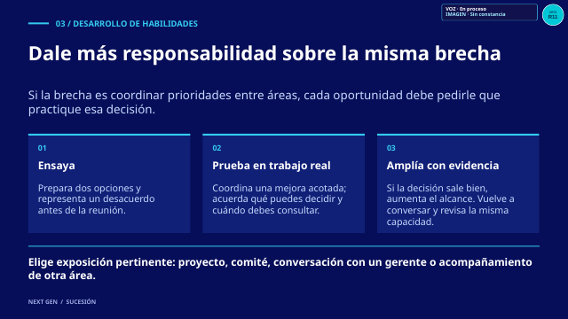

# Lámina 036 · ID PPT 331

## Trazabilidad

- XML de origen: `Sucesion_R11_Large_v10_Deduplicada_2026-11-17_0701_GT.xml` (versión 2; Flat OPC).
- SHA-256 del XML: `a31bc4260d3bf3c96678b66efd5bdf2fbc49dafac046904403b2f81e8c430f2d`.
- Procedencia de la miniatura: PNG extraído byte a byte del ZIP de 51 visibles.
- Procedencia de la locución: Cotejada con `Sucesion_R11_Large_v10_Locucion_2026-11-17_0701_GT.txt`.
- Posición física: **036**; orden visible: **028**; ID nativo: **331**.
- Archivo de imagen: `Sucesion_R11_Large_v10_Deduplicada_2026-11-17_0701_GT__036.png` (640 × 360).
- SHA-256 del PNG: `164bc407a943638328ad388a6cde4151abec4007de9d6c02a36a5ab04761ec83`.
- Estado: **visible**.

## Juicio de Sammy (no es veredicto de Randy)

- **Imagen:** 4 · Tres tarjetas coherentes con la paleta y la progresión; aumenta la letra secundaria y hace más visible el salto entre ensayar, probar y ampliar.
- **Locución:** 4 · El ejemplo de Carlos muestra la progresión con autoridad y evidencia. Acorta el inventario de exposiciones y cierra con qué debe observar el líder.
- **Referencia alternativa:** No encontré una alternativa mejor verificada.

## Voz en off

Incrementa la responsabilidad sobre la misma brecha, según el riesgo y la evidencia. Primero Carlos puede ensayar dos alternativas y representar un desacuerdo antes de la reunión. Después podría coordinar una mejora real y acotada entre áreas, con límites claros de decisión y escalamiento. Si demuestra criterio, amplía gradualmente el alcance y vuelve a observar la misma capacidad. La exposición a un comité, un gerente o una comunidad de práctica sirve cuando le permite afrontar una decisión relevante, no solo asistir como espectador. Cada paso termina con una conversación sobre lo ocurrido.
