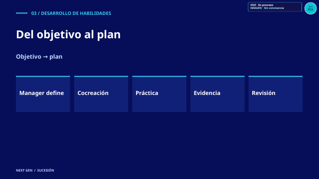

# Lámina 037 · ID PPT 344

## Trazabilidad

- XML de origen: `Sucesion_R11_Large_v10_Deduplicada_2026-11-17_0701_GT.xml` (versión 2; Flat OPC).
- SHA-256 del XML: `a31bc4260d3bf3c96678b66efd5bdf2fbc49dafac046904403b2f81e8c430f2d`.
- Procedencia de la miniatura: PNG extraído byte a byte del ZIP de 51 visibles.
- Procedencia de la locución: Cotejada con `Sucesion_R11_Large_v10_Locucion_2026-11-17_0701_GT.txt`.
- Posición física: **037**; orden visible: **029**; ID nativo: **344**.
- Archivo de imagen: `Sucesion_R11_Large_v10_Deduplicada_2026-11-17_0701_GT__037.png` (640 × 360).
- SHA-256 del PNG: `79990634176ea5e20137c021bad28edf5025aa6d83c7b9286c00e3cb0c6be866`.
- Estado: **visible**.

## Juicio de Sammy (no es veredicto de Randy)

- **Imagen:** 3 · La ruta en cinco tarjetas se entiende, pero «Manager define» rompe el español y todas tienen el mismo peso. Pasa a verbos y destaca inicio y revisión.
- **Locución:** 4 · A y B se convierten en práctica, apoyo y revisión. «Defines… y la conversas» suena unilateral: aclara cuándo define el líder y cuándo acuerdan juntos.
- **Referencia alternativa:** No encontré una alternativa mejor verificada.

## Voz en off

El objetivo nace de comparar A, lo demostrado hoy, con B, la contribución esperada del puesto. Como líder, defines la capacidad que necesita desarrollarse y la conversas con el colaborador. Juntos acuerdan práctica, apoyo, límites, evidencia y revisión. Una formación puede aportar conocimiento; la aplicación se comprueba en el trabajo. En cada revisión deciden si conviene ampliar el reto, repetir la práctica o ajustar las condiciones.
