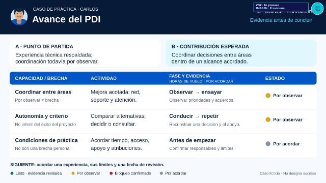

# Lámina 039 · ID PPT 332

## Trazabilidad

- XML de origen: `Sucesion_R11_Large_v10_Deduplicada_2026-11-17_0701_GT.xml` (versión 2; Flat OPC).
- SHA-256 del XML: `a31bc4260d3bf3c96678b66efd5bdf2fbc49dafac046904403b2f81e8c430f2d`.
- Procedencia de la miniatura: PNG extraído byte a byte del ZIP de 51 visibles.
- Procedencia de la locución: Cotejada con `Sucesion_R11_Large_v10_Locucion_2026-11-17_0701_GT.txt`.
- Posición física: **039**; orden visible: **030**; ID nativo: **332**.
- Archivo de imagen: `Sucesion_R11_Large_v10_Deduplicada_2026-11-17_0701_GT__039.png` (640 × 360).
- SHA-256 del PNG: `96fcd8bde0a024c5c9bcd939907d61d28a05e2ffbe76254cbaa65b41abdf5530`.
- Estado: **visible**.

## Juicio de Sammy (no es veredicto de Randy)

- **Imagen:** 3 · El contraste A/B y los estados tienen buena jerarquía, pero la matriz es densa para proyectar. Muestra una fila completa y deja el resto como ficha de apoyo.
- **Locución:** 5 · Distingue con precisión resultado, aprendizaje y autonomía. El contraejemplo del líder resolviendo desacuerdos aclara por qué una entrega no demuestra criterio.
- **Referencia alternativa:** No encontré una alternativa mejor verificada.

## Voz en off

El PDI de Carlos puede convertir esa brecha en un acuerdo de trabajo. La capacidad por observar es coordinar decisiones entre áreas. Acordarían una mejora acotada entre red, soporte y atención al cliente, con un resultado claro, acceso a la información y límites de autoridad. La evidencia incluirá alternativas comparadas, acuerdos, consecuencias y apoyo utilizado. Al revisar, separa tres cosas: qué mejoró en la operación, qué aprendió Carlos y qué puede decidir con autonomía. Si su líder resolvió los desacuerdos, la entrega puede haberse completado, pero aún faltaría comprobar el criterio de Carlos.
