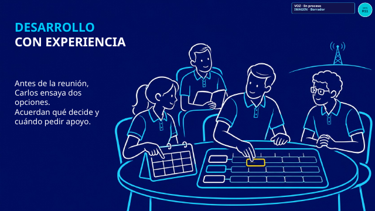

# Lámina 041 · ID PPT 314

## Trazabilidad

- XML de origen: `Sucesion_R11_Large_v10_Deduplicada_2026-11-17_0701_GT.xml` (versión 2; Flat OPC).
- SHA-256 del XML: `a31bc4260d3bf3c96678b66efd5bdf2fbc49dafac046904403b2f81e8c430f2d`.
- Procedencia de la miniatura: PNG extraído byte a byte del ZIP de 51 visibles.
- Procedencia de la locución: Cotejada con `Sucesion_R11_Large_v10_Locucion_2026-11-17_0701_GT.txt`.
- Posición física: **041**; orden visible: **032**; ID nativo: **314**.
- Archivo de imagen: `Sucesion_R11_Large_v10_Deduplicada_2026-11-17_0701_GT__041.png` (640 × 360).
- SHA-256 del PNG: `310769f815cd285d630ff30de5eec54b466e13f621ca23f613a044bf6f84e2b9`.
- Estado: **visible**.

## Juicio de Sammy (no es veredicto de Randy)

- **Imagen:** 4 · La escena delineada domina bien el fondo nocturno. Ajusta el bloque de texto y muestra quién conduce o escala la decisión, en vez de una reunión genérica.
- **Locución:** 5 · El caso muestra cómo el líder deja actuar a Carlos y cómo ambos revisan evidencia. Las consecuencias de cada opción hacen observable la capacidad.
- **Referencia alternativa:** No encontré una alternativa mejor verificada.

## Voz en off

Antes de un comité, Carlos observa cómo su líder maneja una objeción y luego ensaya dos opciones. Una puede mejorar el tiempo de su área y dejar un problema pendiente en atención al cliente. Su líder le pide explicar ambos efectos. Durante la reunión, Carlos conduce la coordinación y escala lo que excede su autoridad. Después revisan qué acuerdos cumplió cada área y qué decisión debería volver a practicar. El líder observa y apoya sin resolverlo todo por él. Registran en el PDI la evidencia, las condiciones y una fecha para repetir la coordinación en una situación diferente.
