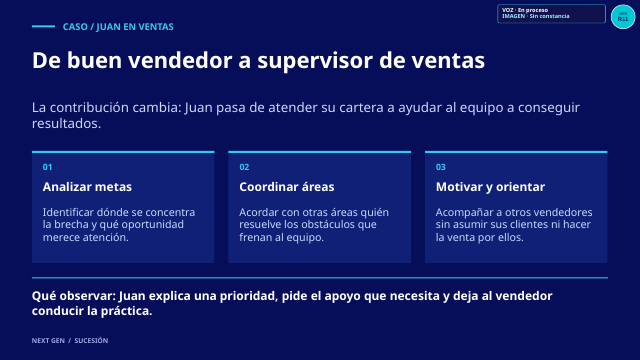

# Lámina 043 · ID PPT 328

## Trazabilidad

- XML de origen: `Sucesion_R11_Large_v10_Deduplicada_2026-11-17_0701_GT.xml` (versión 2; Flat OPC).
- SHA-256 del XML: `a31bc4260d3bf3c96678b66efd5bdf2fbc49dafac046904403b2f81e8c430f2d`.
- Procedencia de la miniatura: PNG extraído byte a byte del ZIP de 51 visibles.
- Procedencia de la locución: Cotejada con `Sucesion_R11_Large_v10_Locucion_2026-11-17_0701_GT.txt`.
- Posición física: **043**; orden visible: **033**; ID nativo: **328**.
- Archivo de imagen: `Sucesion_R11_Large_v10_Deduplicada_2026-11-17_0701_GT__043.png` (640 × 360).
- SHA-256 del PNG: `691696a6a528257a86bdd6a3209242716657199683379937ae63a1453f9954fd`.
- Estado: **visible**.

## Juicio de Sammy (no es veredicto de Randy)

- **Imagen:** 4 · Bien resuelta la comparación en tarjetas, aunque la frase de intro, párrafos y pie reducen el impacto. Destaca los tres verbos y deja la explicación en voz.
- **Locución:** 4 · Separa el logro individual del resultado del equipo. Se puede condensar el perfil del supervisor sin perder qué observarán en Juan.
- **Referencia alternativa:** No encontré una alternativa mejor verificada.

## Voz en off

Juan también necesita practicar responsabilidades distintas a sus ventas individuales. Un supervisor comercial analiza las metas del conjunto, identifica dónde se concentran las oportunidades y coordina con otras áreas para resolver obstáculos. Además, orienta y motiva a los vendedores para que mejoren sus resultados. En el caso de Juan, el aprendizaje no consistirá en cerrar más ventas personalmente. La evidencia estará en cómo explica prioridades, consigue apoyos y deja que el vendedor conduzca su trabajo.
