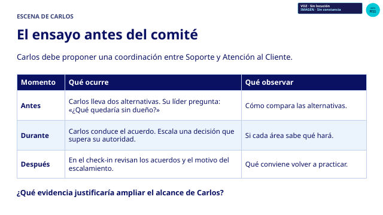

# Lámina 044 · ID PPT 334

## Trazabilidad

- XML de origen: `Sucesion_R11_Large_v10_Deduplicada_2026-11-17_0701_GT.xml` (versión 2; Flat OPC).
- SHA-256 del XML: `a31bc4260d3bf3c96678b66efd5bdf2fbc49dafac046904403b2f81e8c430f2d`.
- Procedencia de la miniatura: Exportada desde una copia con las láminas ocultas incluidas; el XML fuente no se alteró.
- Procedencia de la locución: Notas del XML; esta lámina no estaba en el TXT de las visibles.
- Posición física: **044**; ID nativo: **334**.
- Archivo de imagen: `Sucesion_R11_Large_v10_Deduplicada_2026-11-17_0701_GT__044.png` (640 × 360).
- SHA-256 del PNG: `8c7c3d179d377dce8112163c3f4efc50a43176af452fe86b62d9e989e071502c`.
- Estado: **oculta en el XML; marcado para eliminar**.

## Juicio de Sammy (no es veredicto de Randy)

- **Imagen:** 2/5 · Tres filas de tabla azul y blanca se leen como documento; el desafío final al pie tiene más interés que la composición.
- **Locución:** El antes/durante/después funciona si se cuenta la decisión observada, sin leer toda la matriz.
- **Referencia alternativa:** [Lámina 041](../041/Sucesion_R11_Large_v10_Deduplicada_2026-11-17_0701_GT__041.png) · Pone el ensayo de dos opciones de Carlos en primer plano sin la matriz completa.

## Voz en off

*Sin locución publicable separada con certeza de las notas editoriales, o sin notas en el XML.*
