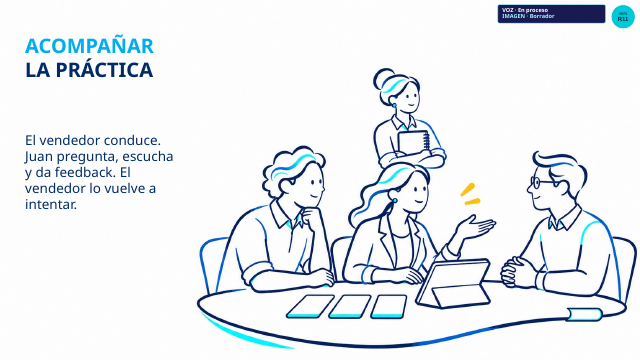

# Lámina 045 · ID PPT 315

## Trazabilidad

- XML de origen: `Sucesion_R11_Large_v10_Deduplicada_2026-11-17_0701_GT.xml` (versión 2; Flat OPC).
- SHA-256 del XML: `a31bc4260d3bf3c96678b66efd5bdf2fbc49dafac046904403b2f81e8c430f2d`.
- Procedencia de la miniatura: PNG extraído byte a byte del ZIP de 51 visibles.
- Procedencia de la locución: Cotejada con `Sucesion_R11_Large_v10_Locucion_2026-11-17_0701_GT.txt`.
- Posición física: **045**; orden visible: **034**; ID nativo: **315**.
- Archivo de imagen: `Sucesion_R11_Large_v10_Deduplicada_2026-11-17_0701_GT__045.png` (640 × 360).
- SHA-256 del PNG: `23c182562e88bf94064c67c0d460ace7a2bd921ec9f0ab9fb92fceaafef38b7f`.
- Estado: **visible**.

## Juicio de Sammy (no es veredicto de Randy)

- **Imagen:** 4 · Trazo y paleta Tigo claros. El dibujo grupal no indica del todo quién lleva la conversación; destaca al vendedor y deja a Juan deliberadamente al margen.
- **Locución:** 5 · Enseña a acompañar sin resolver por otro. Ensayo, escucha, retroalimentación y segundo intento muestran la decisión y el aprendizaje.
- **Referencia alternativa:** No encontré una alternativa mejor verificada.

## Voz en off

El jefe pide a Juan acompañar a un vendedor que pierde oportunidades después del primer contacto. Antes de la siguiente conversación ensayan una objeción y acuerdan quién la conducirá. Durante el encuentro, el vendedor habla y Juan escucha, aunque podría intervenir para cerrar. Después Juan pregunta qué quedó acordado, ofrece retroalimentación concreta y deja que el compañero vuelva a intentar. Observa si el vendedor establece el siguiente paso sin depender de él. La mejora importa por la capacidad que construye en el compañero, además del resultado comercial. Juan también está aprendiendo a liderar.
