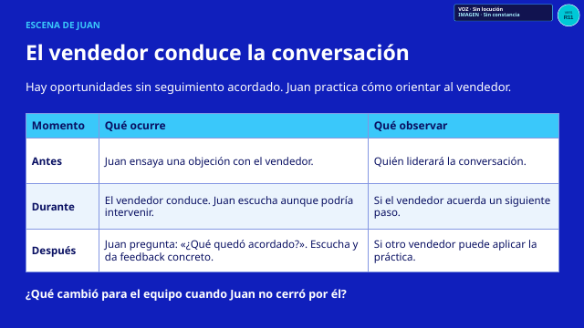

# Lámina 046 · ID PPT 335

## Trazabilidad

- XML de origen: `Sucesion_R11_Large_v10_Deduplicada_2026-11-17_0701_GT.xml` (versión 2; Flat OPC).
- SHA-256 del XML: `a31bc4260d3bf3c96678b66efd5bdf2fbc49dafac046904403b2f81e8c430f2d`.
- Procedencia de la miniatura: Exportada desde una copia con las láminas ocultas incluidas; el XML fuente no se alteró.
- Procedencia de la locución: Notas del XML; esta lámina no estaba en el TXT de las visibles.
- Posición física: **046**; ID nativo: **335**.
- Archivo de imagen: `Sucesion_R11_Large_v10_Deduplicada_2026-11-17_0701_GT__046.png` (640 × 360).
- SHA-256 del PNG: `ff34adbc9eedd857b56a1531e1813c945a1414bb505fb6a1a16a7f9ca7b993ec`.
- Estado: **oculta en el XML; marcado para eliminar**.

## Juicio de Sammy (no es veredicto de Randy)

- **Imagen:** 2/5 · La tabla de tres momentos domina la mancha y el azul eléctrico ahoga las diferencias entre filas.
- **Locución:** El verbo clave es escuchar sin intervenir; pondría ahí el énfasis y dejaría las tres fases como apoyo.
- **Referencia alternativa:** [Lámina 045](../045/Sucesion_R11_Large_v10_Deduplicada_2026-11-17_0701_GT__045.png) · Concentra el gesto de preguntar y escuchar en la lámina visible del mismo caso.

## Voz en off

*Sin locución publicable separada con certeza de las notas editoriales, o sin notas en el XML.*
