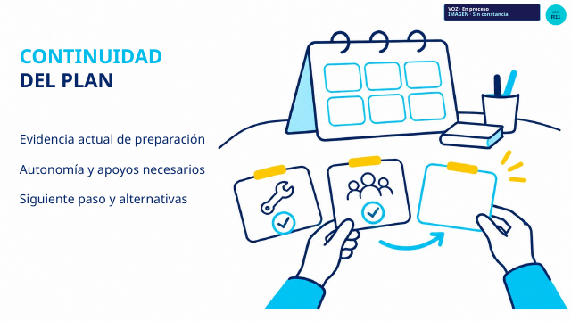

# Lámina 048 · ID PPT 317

## Trazabilidad

- XML de origen: `Sucesion_R11_Large_v10_Deduplicada_2026-11-17_0701_GT.xml` (versión 2; Flat OPC).
- SHA-256 del XML: `a31bc4260d3bf3c96678b66efd5bdf2fbc49dafac046904403b2f81e8c430f2d`.
- Procedencia de la miniatura: PNG extraído byte a byte del ZIP de 51 visibles.
- Procedencia de la locución: Cotejada con `Sucesion_R11_Large_v10_Locucion_2026-11-17_0701_GT.txt`.
- Posición física: **048**; orden visible: **036**; ID nativo: **317**.
- Archivo de imagen: `Sucesion_R11_Large_v10_Deduplicada_2026-11-17_0701_GT__048.png` (640 × 360).
- SHA-256 del PNG: `49d23a15c626aff53dfc2b915f301dcd8c31f70168481211492c30eb6434ddc0`.
- Estado: **visible**.

## Juicio de Sammy (no es veredicto de Randy)

- **Imagen:** 4 · La agenda y tarjetas funcionan y el fondo blanco respira, pero no distinguen preparación, disponibilidad y cobertura. Etiqueta cada recurso o simplifica los apoyos.
- **Locución:** 4 · Aclara que cobertura no es preparación; recorta condiciones repetidas y termina con el siguiente paso y la revisión.
- **Referencia alternativa:** No encontré una alternativa mejor verificada.

## Voz en off

Revisa juntas la preparación, la disponibilidad y la cobertura del puesto. Una cobertura temporal define funciones, responsables y límites; no equivale a que una persona esté lista para una transición permanente. La preparación requiere evidencia de las decisiones que puede sostener y del apoyo que todavía necesita. Si una práctica mueve al colaborador a otra área, acuerda también quién atenderá su trabajo habitual. Registra qué cambió, quién hará la próxima acción y cuándo revisarán la evidencia. Si no existe una alternativa interesada o preparada, consulta opciones con Tigo People y los líderes correspondientes, sin rebajar las exigencias del rol ni prometer un nombramiento.
