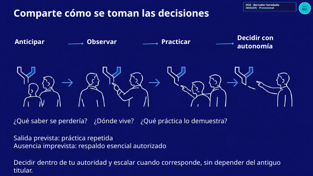

# Lámina 050 · ID PPT 319

## Trazabilidad

- XML de origen: `Sucesion_R11_Large_v10_Deduplicada_2026-11-17_0701_GT.xml` (versión 2; Flat OPC).
- SHA-256 del XML: `a31bc4260d3bf3c96678b66efd5bdf2fbc49dafac046904403b2f81e8c430f2d`.
- Procedencia de la miniatura: PNG extraído byte a byte del ZIP de 51 visibles.
- Procedencia de la locución: Cotejada con `Sucesion_R11_Large_v10_Locucion_2026-11-17_0701_GT.txt`.
- Posición física: **050**; orden visible: **037**; ID nativo: **319**.
- Archivo de imagen: `Sucesion_R11_Large_v10_Deduplicada_2026-11-17_0701_GT__050.png` (640 × 360).
- SHA-256 del PNG: `deb7db54d991a039fc065cf5954e766f67a074b78011a16e16a2d142b433a5a4`.
- Estado: **visible**.

## Juicio de Sammy (no es veredicto de Randy)

- **Imagen:** 3 · La secuencia de cuatro pasos es pertinente, pero el solapamiento de ilustración, preguntas y escenarios vuelve el pie difícil de leer. Separa ruta de advertencias.
- **Locución:** 5 · Transferir criterio, no solo procedimiento, se entiende por la decisión reciente y el caso comparable. Conserva la distinción y sus límites.
- **Referencia alternativa:** No encontré una alternativa mejor verificada.

## Voz en off

Transferir conocimiento exige compartir cómo se toman las decisiones. El procedimiento habitual puede omitir una excepción, una relación importante o la señal que te hace cambiar de prioridad. Elige una decisión reciente y explica qué observaste, qué opciones comparaste, por qué elegiste una y qué información habría cambiado tu respuesta. Después permite que el colaborador practique un caso comparable dentro de sus atribuciones. Presenta a las personas con las que deberá coordinar y aclara cuándo debe consultar o escalar. Si el equipo sigue dependiendo del titular anterior, revisa qué criterio, acceso o responsabilidad quedó pendiente de transferir.
