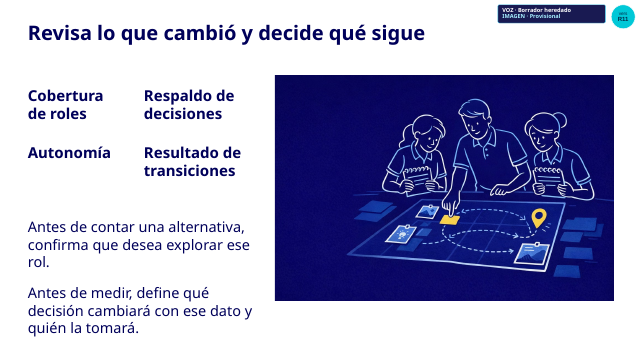

# Lámina 051 · ID PPT 320

## Trazabilidad

- XML de origen: `Sucesion_R11_Large_v10_Deduplicada_2026-11-17_0701_GT.xml` (versión 2; Flat OPC).
- SHA-256 del XML: `a31bc4260d3bf3c96678b66efd5bdf2fbc49dafac046904403b2f81e8c430f2d`.
- Procedencia de la miniatura: PNG extraído byte a byte del ZIP de 51 visibles.
- Procedencia de la locución: Cotejada con `Sucesion_R11_Large_v10_Locucion_2026-11-17_0701_GT.txt`.
- Posición física: **051**; orden visible: **038**; ID nativo: **320**.
- Archivo de imagen: `Sucesion_R11_Large_v10_Deduplicada_2026-11-17_0701_GT__051.png` (640 × 360).
- SHA-256 del PNG: `ac365f750eca49285d9c669e1ee81685f68499c463458bfd85bfcb06038fcf38`.
- Estado: **visible**.

## Juicio de Sammy (no es veredicto de Randy)

- **Imagen:** 3 · Las señales útiles quedan pequeñas y la ilustración oscura parece añadida. Distribuye las cuatro señales en tarjetas claras y reduce el texto secundario.
- **Locución:** 4 · Distingue actividad, habilidad y autonomía. Acorta los dos niveles de revisión para terminar con acción, responsable y fecha.
- **Referencia alternativa:** No encontré una alternativa mejor verificada.

## Voz en off

Da seguimiento a lo acordado, no solamente a las actividades realizadas. Comprueba qué práctica ocurrió, qué habilidad mostró la persona, cuánto apoyo necesitó y qué decidirán después. Si la experiencia se pospuso, acuerda condiciones para realizarla; todavía no es evidencia de aprendizaje. A nivel del programa, observa cobertura de roles, respaldo de decisiones, autonomía y resultados de transiciones. Antes de pedir un indicador, define qué decisión cambiará con ese dato y quién la tomará. Una capacitación completada registra actividad; su aplicación y la autonomía requieren evidencias distintas. Cada revisión debe terminar con una acción, responsable y fecha.
