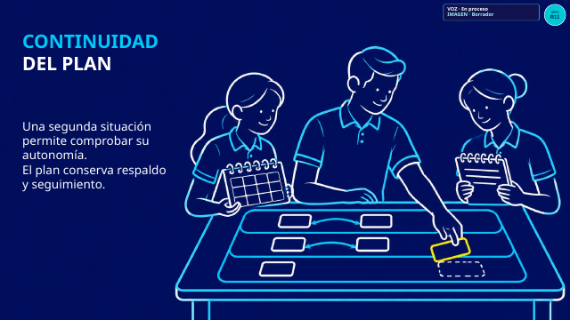

# Lámina 052 · ID PPT 321

## Trazabilidad

- XML de origen: `Sucesion_R11_Large_v10_Deduplicada_2026-11-17_0701_GT.xml` (versión 2; Flat OPC).
- SHA-256 del XML: `a31bc4260d3bf3c96678b66efd5bdf2fbc49dafac046904403b2f81e8c430f2d`.
- Procedencia de la miniatura: PNG extraído byte a byte del ZIP de 51 visibles.
- Procedencia de la locución: Cotejada con `Sucesion_R11_Large_v10_Locucion_2026-11-17_0701_GT.txt`.
- Posición física: **052**; orden visible: **039**; ID nativo: **321**.
- Archivo de imagen: `Sucesion_R11_Large_v10_Deduplicada_2026-11-17_0701_GT__052.png` (640 × 360).
- SHA-256 del PNG: `263c6bb19b69f16dcc27336f9c61e6cda040303cae7612b96df10f5e6bab1a80`.
- Estado: **visible**.

## Juicio de Sammy (no es veredicto de Randy)

- **Imagen:** 4 · Escena nocturna bien integrada y con aire. El tablero puede mostrar una señal de apoyo que baja en la segunda práctica; el texto compite poco con el dibujo.
- **Locución:** 4 · Concreta qué debe comprobar el líder en el segundo intento. La última mención de Andrea abre un hilo distinto; úsala solo si el siguiente slide lo retoma.
- **Referencia alternativa:** No encontré una alternativa mejor verificada.

## Voz en off

Carlos coordina una segunda situación con menos apoyo. El líder revisa cómo priorizó, qué comunicó, qué resolvió dentro de su autoridad y qué escaló. Comprueba el resultado de la entrega completa, no solo que la incidencia terminó. Aún puede necesitar respaldo para algunas decisiones; el plan debe decir quién lo ofrece mientras sigue aprendiendo. Si participa en otra área, también se resuelve la cobertura de sus funciones actuales. La siguiente revisión se apoya en hechos y límites de autonomía, sin prometer un ascenso. La trayectoria de Andrea sigue siendo una decisión por conversar, no una conclusión cerrada.
