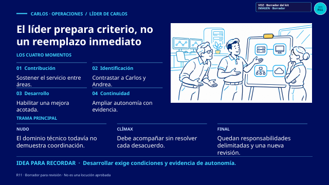

# Lámina 053 · ID PPT 336

## Trazabilidad

- XML de origen: `Sucesion_R11_Large_v10_Deduplicada_2026-11-17_0701_GT.xml` (versión 2; Flat OPC).
- SHA-256 del XML: `a31bc4260d3bf3c96678b66efd5bdf2fbc49dafac046904403b2f81e8c430f2d`.
- Procedencia de la miniatura: PNG extraído byte a byte del ZIP de 51 visibles.
- Procedencia de la locución: Cotejada con `Sucesion_R11_Large_v10_Locucion_2026-11-17_0701_GT.txt`.
- Posición física: **053**; orden visible: **040**; ID nativo: **336**.
- Archivo de imagen: `Sucesion_R11_Large_v10_Deduplicada_2026-11-17_0701_GT__053.png` (640 × 360).
- SHA-256 del PNG: `4ab5b903626fa3197bacb996173da2b8ee7aacc084abe4383d475301afad998d`.
- Estado: **visible**.

## Juicio de Sammy (no es veredicto de Randy)

- **Imagen:** 2 · Cuatro momentos, hilo narrativo, idea final e ilustración quedan apretados. Prioriza las decisiones del líder y mueve el resto a la guía del facilitador.
- **Locución:** 4 · Resume con claridad el arco de decisiones del líder. Funciona como recapitulación, no como segundo relato de los mismos hechos.
- **Referencia alternativa:** No encontré una alternativa mejor verificada.

## Voz en off

Mira ahora el caso de Carlos desde las decisiones de su líder. Primero define qué exige coordinar la operación. Después compara a Carlos y Andrea con evidencias e interés, sin elegir todavía un sucesor. Organiza una mejora pequeña entre áreas y acuerda autoridad, apoyo y cobertura. En la práctica debe resistir la tentación de resolver cada desacuerdo por Carlos. Por último, observa una segunda situación y registra qué puede decidir con autonomía. Su resultado es un plan verificable, con responsabilidades y revisión, no un nombramiento anticipado.
