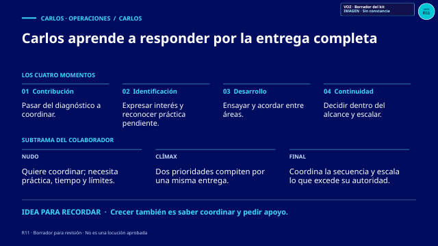

# Lámina 054 · ID PPT 337

## Trazabilidad

- XML de origen: `Sucesion_R11_Large_v10_Deduplicada_2026-11-17_0701_GT.xml` (versión 2; Flat OPC).
- SHA-256 del XML: `a31bc4260d3bf3c96678b66efd5bdf2fbc49dafac046904403b2f81e8c430f2d`.
- Procedencia de la miniatura: PNG extraído byte a byte del ZIP de 51 visibles.
- Procedencia de la locución: Cotejada con `Sucesion_R11_Large_v10_Locucion_2026-11-17_0701_GT.txt`.
- Posición física: **054**; orden visible: **041**; ID nativo: **337**.
- Archivo de imagen: `Sucesion_R11_Large_v10_Deduplicada_2026-11-17_0701_GT__054.png` (640 × 360).
- SHA-256 del PNG: `dc1714f905679118b6f0a784b2fbcc1ce404128610edb1afa526980e11004989`.
- Estado: **visible**.

## Juicio de Sammy (no es veredicto de Randy)

- **Imagen:** 2 · La tabla recoge bien las fases, pero parece ficha de producción. Haría visible la evolución de Carlos con una línea de tres acciones y espacio.
- **Locución:** 4 · La perspectiva de Carlos añade intención y el límite de escalar. Abrevia fuertemente si sigue inmediatamente a 053.
- **Referencia alternativa:** No encontré una alternativa mejor verificada.

## Voz en off

Desde la perspectiva de Carlos, el reto es distinto. Domina los procedimientos, pero quiere comprender y coordinar la entrega completa. Expresa su interés y reconoce que necesita práctica para priorizar entre áreas. Observa una conversación, ensaya alternativas y conduce una mejora dentro de los límites acordados. Cuando dos prioridades compiten, explica los efectos y escala aquello que excede su autoridad. Aprende a asumir decisiones con criterio, sin fingir que tiene todas las respuestas. Lo siguiente es comprobar si puede repetir ese aprendizaje en otra situación.
