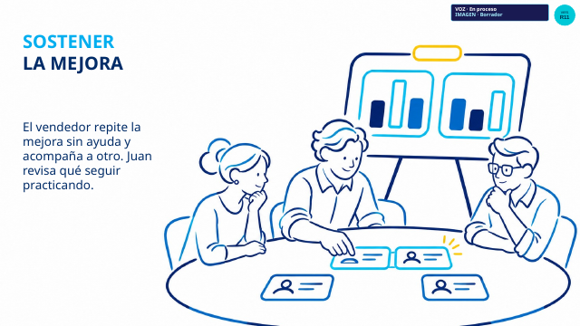

# Lámina 055 · ID PPT 322

## Trazabilidad

- XML de origen: `Sucesion_R11_Large_v10_Deduplicada_2026-11-17_0701_GT.xml` (versión 2; Flat OPC).
- SHA-256 del XML: `a31bc4260d3bf3c96678b66efd5bdf2fbc49dafac046904403b2f81e8c430f2d`.
- Procedencia de la miniatura: PNG extraído byte a byte del ZIP de 51 visibles.
- Procedencia de la locución: Cotejada con `Sucesion_R11_Large_v10_Locucion_2026-11-17_0701_GT.txt`.
- Posición física: **055**; orden visible: **042**; ID nativo: **322**.
- Archivo de imagen: `Sucesion_R11_Large_v10_Deduplicada_2026-11-17_0701_GT__055.png` (640 × 360).
- SHA-256 del PNG: `87a4e71a2f459c505d18ddcfef8fffb14b6aa2a9b265ac2dca6d1036b6c988d5`.
- Estado: **visible**.

## Juicio de Sammy (no es veredicto de Randy)

- **Imagen:** 4 · La escena y el tablero azul sobre blanco se leen; conviene enfatizar quién enseña a quién para que se vea la transferencia, no una reunión comercial genérica.
- **Locución:** 5 · El vendedor repite y enseña el criterio; es evidencia concreta de sostenibilidad sin convertirla en nombramiento.
- **Referencia alternativa:** No encontré una alternativa mejor verificada.

## Voz en off

El compañero de Juan aplica la mejora en nuevas conversaciones y puede explicar qué cambió. Después ayuda a otro vendedor a utilizar el mismo criterio. Juan observa ese aprendizaje, identifica una necesidad nueva y propone el siguiente paso. Su jefe contrasta lo ocurrido con la contribución del puesto: qué puede asumir Juan, qué necesita seguir practicando y cuándo volverán a revisar. Es evidencia para continuar el desarrollo, no una designación automática.
