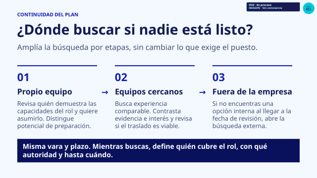

# Lámina 056 · ID PPT 338

## Trazabilidad

- XML de origen: `Sucesion_R11_Large_v10_Deduplicada_2026-11-17_0701_GT.xml` (versión 2; Flat OPC).
- SHA-256 del XML: `a31bc4260d3bf3c96678b66efd5bdf2fbc49dafac046904403b2f81e8c430f2d`.
- Procedencia de la miniatura: PNG extraído byte a byte del ZIP de 51 visibles.
- Procedencia de la locución: Cotejada con `Sucesion_R11_Large_v10_Locucion_2026-11-17_0701_GT.txt`.
- Posición física: **056**; orden visible: **043**; ID nativo: **338**.
- Archivo de imagen: `Sucesion_R11_Large_v10_Deduplicada_2026-11-17_0701_GT__056.png` (640 × 360).
- SHA-256 del PNG: `d838d1db2d5aeb4a50f8e3df4675b3dfc03904a0b97b8c364d5a127ba22372cb`.
- Estado: **visible**.

## Juicio de Sammy (no es veredicto de Randy)

- **Imagen:** 4 · La ruta de búsqueda tiene pasos claros y orden visual. Reduce descripciones y convierte cobertura, autoridad y plazo en una franja de decisión legible.
- **Locución:** 5 · Responde directamente una necesidad del mando medio: orden, mismo criterio y cobertura durante la búsqueda.
- **Referencia alternativa:** No encontré una alternativa mejor verificada.

## Voz en off

¿Qué hacer si todavía nadie está preparado o interesado? Amplía la búsqueda por etapas, manteniendo el mismo perfil y criterio. Revisa primero tu equipo; después considera experiencia comparable en equipos cercanos y conversa con sus responsables. Si no aparece una alternativa interna viable al llegar a la fecha acordada, revisa por los canales correspondientes una búsqueda externa. En cada etapa comprueba capacidad, interés, disponibilidad y autorizaciones. Mientras decides, define quién cubre las funciones esenciales, con qué autoridad y hasta cuándo.
