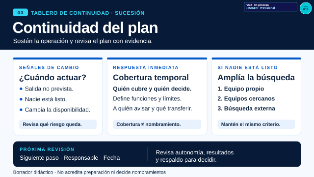

# Lámina 058 · ID PPT 340

## Trazabilidad

- XML de origen: `Sucesion_R11_Large_v10_Deduplicada_2026-11-17_0701_GT.xml` (versión 2; Flat OPC).
- SHA-256 del XML: `a31bc4260d3bf3c96678b66efd5bdf2fbc49dafac046904403b2f81e8c430f2d`.
- Procedencia de la miniatura: PNG extraído byte a byte del ZIP de 51 visibles.
- Procedencia de la locución: Cotejada con `Sucesion_R11_Large_v10_Locucion_2026-11-17_0701_GT.txt`.
- Posición física: **058**; orden visible: **044**; ID nativo: **340**.
- Archivo de imagen: `Sucesion_R11_Large_v10_Deduplicada_2026-11-17_0701_GT__058.png` (640 × 360).
- SHA-256 del PNG: `8272c29f1f097ec928bcf23373e2aae03066bcd3422e5cb98c8570cf13da1e78`.
- Estado: **visible**.

## Juicio de Sammy (no es veredicto de Randy)

- **Imagen:** 3 · Las tres decisiones están bien agrupadas, pero la mezcla de encabezados, avisos y pie achica el texto. Eleva cobertura temporal y fecha de revisión.
- **Locución:** 4 · Conecta contingencia con cobertura, revisión y comunicación mínima. El primer ejemplo podría bastar para evitar repetir 056.
- **Referencia alternativa:** No encontré una alternativa mejor verificada.

## Voz en off

El plan también debe responder cuando cambian las condiciones. Si alguien deja de estar disponible, hay un conflicto de interés o la práctica se detiene, revisa la evidencia, los apoyos y la alternativa. Ante una ausencia inesperada, asigna cobertura temporal: responsable, funciones esenciales, límites de autoridad y fecha de revisión. Si nadie cumple el criterio, amplía la búsqueda sin rebajarlo. Registra el siguiente paso y comunica a cada área solamente la información que necesita para continuar el trabajo. La continuidad es una decisión revisable, no una lista de nombres inmóvil.
