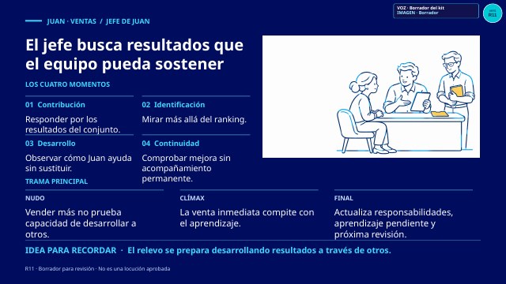

# Lámina 059 · ID PPT 341

## Trazabilidad

- XML de origen: `Sucesion_R11_Large_v10_Deduplicada_2026-11-17_0701_GT.xml` (versión 2; Flat OPC).
- SHA-256 del XML: `a31bc4260d3bf3c96678b66efd5bdf2fbc49dafac046904403b2f81e8c430f2d`.
- Procedencia de la miniatura: PNG extraído byte a byte del ZIP de 51 visibles.
- Procedencia de la locución: Cotejada con `Sucesion_R11_Large_v10_Locucion_2026-11-17_0701_GT.txt`.
- Posición física: **059**; orden visible: **045**; ID nativo: **341**.
- Archivo de imagen: `Sucesion_R11_Large_v10_Deduplicada_2026-11-17_0701_GT__059.png` (640 × 360).
- SHA-256 del PNG: `7a936c6e6327aaf6d03218af7b0e9b13a1196c104523611a3d43af1808774bb9`.
- Estado: **visible**.

## Juicio de Sammy (no es veredicto de Randy)

- **Imagen:** 2 · Ilustración y tabla de fases no forman una unidad; el cuerpo es pequeño y el borde blanco pesa. Resume las decisiones del jefe, no toda la ficha.
- **Locución:** 4 · El dilema de intervenir es útil y muestra el papel del jefe. Quita lo ya explicado en 043/045 si esta lámina se conserva.
- **Referencia alternativa:** No encontré una alternativa mejor verificada.

## Voz en off

Desde la perspectiva del jefe de Juan, los buenos resultados individuales lo convierten en una posibilidad, todavía no en una respuesta. El jefe define el resultado esperado del supervisor: un equipo que consigue sus metas y desarrolla capacidades. Explora el interés de Juan junto con las evidencias de otros perfiles. Cuando Juan quiere cerrar una venta por su compañero, lo orienta para que pregunte, escuche y permita otro intento. Después revisa si el compañero puede sostener la mejora. Esa evidencia alimenta el plan y la siguiente decisión, sin nombrar automáticamente a nadie.
