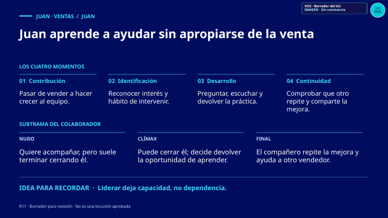

# Lámina 060 · ID PPT 342

## Trazabilidad

- XML de origen: `Sucesion_R11_Large_v10_Deduplicada_2026-11-17_0701_GT.xml` (versión 2; Flat OPC).
- SHA-256 del XML: `a31bc4260d3bf3c96678b66efd5bdf2fbc49dafac046904403b2f81e8c430f2d`.
- Procedencia de la miniatura: PNG extraído byte a byte del ZIP de 51 visibles.
- Procedencia de la locución: Cotejada con `Sucesion_R11_Large_v10_Locucion_2026-11-17_0701_GT.txt`.
- Posición física: **060**; orden visible: **046**; ID nativo: **342**.
- Archivo de imagen: `Sucesion_R11_Large_v10_Deduplicada_2026-11-17_0701_GT__060.png` (640 × 360).
- SHA-256 del PNG: `34e406438505f308fb3cabba184546cd0f03d917f5d99b982ea1e313952d7ef4`.
- Estado: **visible**.

## Juicio de Sammy (no es veredicto de Randy)

- **Imagen:** 2 · Mapa de decisiones denso, sin un foco gráfico que haga visible el cambio. Convierte el contraste cerrar por otro → dejar practicar en el foco.
- **Locución:** 4 · El aprendizaje de Juan queda claro, pero el relato repite 045 y 055. Quédate con el momento en que cede la decisión y comprueba el siguiente paso.
- **Referencia alternativa:** No encontré una alternativa mejor verificada.

## Voz en off

Juan vive la misma historia desde su aprendizaje. Sabe vender, desea acompañar a otros y descubre que intervenir para asegurar cada cierre puede impedir que su compañero practique. Con apoyo de su jefe aprende a hacer preguntas y dar retroalimentación concreta. Cuando el vendedor vuelve a intentarlo, Juan observa la decisión que toma y el siguiente paso que acuerda. En el cierre del caso, el compañero repite la mejora y ayuda a otro. Juan empieza a contribuir a través de los resultados que otros pueden sostener, mientras su propia preparación sigue en revisión.
