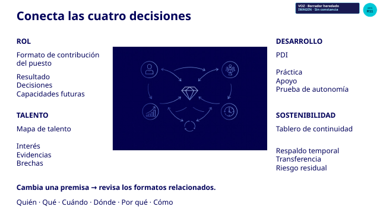

# Lámina 062 · ID PPT 324

## Trazabilidad

- XML de origen: `Sucesion_R11_Large_v10_Deduplicada_2026-11-17_0701_GT.xml` (versión 2; Flat OPC).
- SHA-256 del XML: `a31bc4260d3bf3c96678b66efd5bdf2fbc49dafac046904403b2f81e8c430f2d`.
- Procedencia de la miniatura: PNG extraído byte a byte del ZIP de 51 visibles.
- Procedencia de la locución: Cotejada con `Sucesion_R11_Large_v10_Locucion_2026-11-17_0701_GT.txt`.
- Posición física: **062**; orden visible: **048**; ID nativo: **324**.
- Archivo de imagen: `Sucesion_R11_Large_v10_Deduplicada_2026-11-17_0701_GT__062.png` (640 × 360).
- SHA-256 del PNG: `9718bd04594a380d85c73816ce62e2d812085694b675003d82246b06ef592390`.
- Estado: **visible**.

## Juicio de Sammy (no es veredicto de Randy)

- **Imagen:** 3 · El esquema correcto queda oscuro y pequeño; las cuatro listas parecen inventario. Usa un ciclo grande con cuatro etiquetas y relieve a la revisión.
- **Locución:** 4 · Explica cómo cada instrumento alimenta al siguiente. Revisa «conserva lo que sigue siendo válido» para que termine con una acción concreta.
- **Referencia alternativa:** No encontré una alternativa mejor verificada.

## Voz en off

Las cuatro decisiones se conectan. El formato de contribución aclara qué trabajo debe sostenerse. La identificación reúne evidencias e intereses. El PDI transforma una brecha en práctica, apoyo y comprobación. La continuidad define respaldo, transferencia y revisión. En Carlos, la coordinación entre áreas une esos cuatro instrumentos. Si cambia el puesto, la oportunidad de práctica o el interés del colaborador, revisa los acuerdos relacionados. Conserva lo que sigue siendo válido y señala qué necesitas comprobar. Así podrás explicar por qué tomaste cada decisión y qué acción corresponde después.
