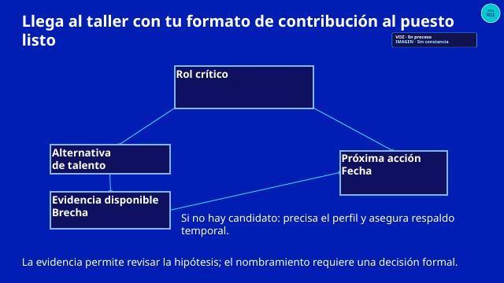

# Lámina 063 · ID PPT 325

## Trazabilidad

- XML de origen: `Sucesion_R11_Large_v10_Deduplicada_2026-11-17_0701_GT.xml` (versión 2; Flat OPC).
- SHA-256 del XML: `a31bc4260d3bf3c96678b66efd5bdf2fbc49dafac046904403b2f81e8c430f2d`.
- Procedencia de la miniatura: PNG extraído byte a byte del ZIP de 51 visibles.
- Procedencia de la locución: Cotejada con `Sucesion_R11_Large_v10_Locucion_2026-11-17_0701_GT.txt`.
- Posición física: **063**; orden visible: **049**; ID nativo: **325**.
- Archivo de imagen: `Sucesion_R11_Large_v10_Deduplicada_2026-11-17_0701_GT__063.png` (640 × 360).
- SHA-256 del PNG: `d49c77f5eb0e020460fbf3e0c82d9db752aceee70c10e0394af32ab2b80c43e5`.
- Estado: **visible**.

## Juicio de Sammy (no es veredicto de Randy)

- **Imagen:** 2 · Las cajas de texto y líneas finas no guían la lectura. Usa un checklist visual y deja el caso sin candidato como alternativa, no como nota perdida.
- **Locución:** 5 · El taller queda ligado a entregables accionables y distingue preparar una propuesta de nombrar. Puede recortarse sin cambiar requisitos.
- **Referencia alternativa:** No encontré una alternativa mejor verificada.

## Voz en off

Llega al taller con el formato de contribución de tu propio puesto listo para revisar. Identifica qué resultado debe sostenerse, qué capacidades requiere y qué evidencia tienes sobre una posible alternativa. Si todavía no hay alguien interesado o preparado, anótalo con claridad. Piensa en una experiencia real que permita comprobar la capacidad prioritaria, con condiciones y apoyo viables. Durante el taller precisarás la próxima acción, el responsable y la fecha de revisión. Llevar una propuesta fundamentada permite conversar y decidir; no equivale a seleccionar formalmente a un sucesor.
