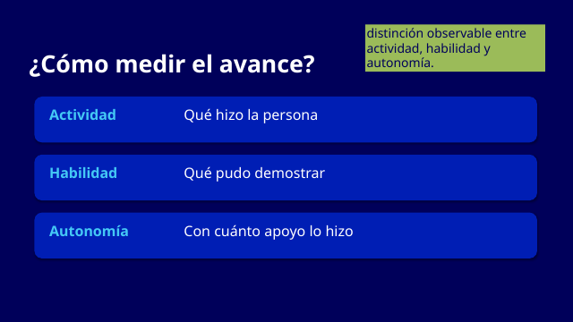

# Lámina 064 · ID PPT 358

## Trazabilidad

- XML de origen: `Sucesion_R11_Large_v10_Deduplicada_2026-11-17_0701_GT.xml` (versión 2; Flat OPC).
- SHA-256 del XML: `a31bc4260d3bf3c96678b66efd5bdf2fbc49dafac046904403b2f81e8c430f2d`.
- Procedencia de la miniatura: PNG extraído byte a byte del ZIP de 51 visibles.
- Procedencia de la locución: Cotejada con `Sucesion_R11_Large_v10_Locucion_2026-11-17_0701_GT.txt`.
- Posición física: **064**; orden visible: **050**; ID nativo: **358**.
- Archivo de imagen: `Sucesion_R11_Large_v10_Deduplicada_2026-11-17_0701_GT__064.png` (640 × 360).
- SHA-256 del PNG: `6e3edd676b0ab5cc5000b9cf04f9e47ae534d745545f0574b9532282b133128e`.
- Estado: **visible**.

## Juicio de Sammy (no es veredicto de Randy)

- **Imagen:** 2 · Las tres bandas son útiles, pero el post-it verde parece comentario editorial e interrumpe la jerarquía. Elimínalo y asegura contraste en los títulos.
- **Locución:** 5 · Diferencia actividad, habilidad y autonomía con el mismo criterio y una comparación memorable.
- **Referencia alternativa:** No encontré una alternativa mejor verificada.

## Voz en off

Para medir el avance, separa actividad, habilidad y autonomía. La actividad describe qué hizo la persona; la habilidad, qué pudo demostrar; la autonomía, cuánto apoyo necesitó. Participar en una tarea indica actividad. Resolver una decisión con criterio puede mostrar habilidad. Repetirla con menos apoyo puede aportar evidencia de autonomía. Registra hechos concretos antes de concluir que hubo progreso.
