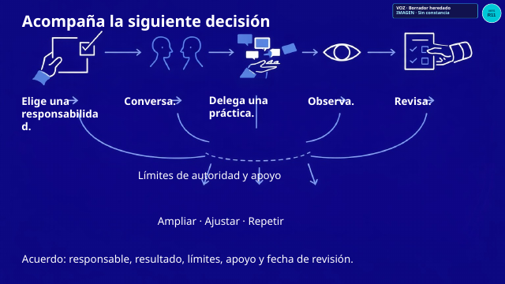

# Lámina 065 · ID PPT 326

## Trazabilidad

- XML de origen: `Sucesion_R11_Large_v10_Deduplicada_2026-11-17_0701_GT.xml` (versión 2; Flat OPC).
- SHA-256 del XML: `a31bc4260d3bf3c96678b66efd5bdf2fbc49dafac046904403b2f81e8c430f2d`.
- Procedencia de la miniatura: PNG extraído byte a byte del ZIP de 51 visibles.
- Procedencia de la locución: Cotejada con `Sucesion_R11_Large_v10_Locucion_2026-11-17_0701_GT.txt`.
- Posición física: **065**; orden visible: **051**; ID nativo: **326**.
- Archivo de imagen: `Sucesion_R11_Large_v10_Deduplicada_2026-11-17_0701_GT__065.png` (640 × 360).
- SHA-256 del PNG: `c95c46091a7d9ddcb25100ce44327aa134026cbb6fccb1a829d41230bd84b45e`.
- Estado: **visible**.

## Juicio de Sammy (no es veredicto de Randy)

- **Imagen:** 2 · Los iconos funcionan, pero hay etiquetas partidas y flechas que se cruzan. Ordena cinco acciones en una línea y separa las condiciones del acuerdo.
- **Locución:** 5 · Retoma la apertura y termina en un acuerdo pequeño y medible. La llamada a la acción merece conservarse.
- **Referencia alternativa:** No encontré una alternativa mejor verificada.

## Voz en off

Vuelve a la decisión que imaginaste al comenzar. Elige una responsabilidad que un colaborador pueda comprender y practicar. Conversa sobre su interés, comparte el criterio que utilizas y acuerda qué podrá decidir y qué deberá consultar. Dale una oportunidad real con apoyo y observa lo ocurrido. En la siguiente revisión podrán ampliar el reto, repetir la práctica o ajustar las condiciones. Deja un acuerdo sencillo: responsable, resultado, límites, apoyo y fecha. Así empieza una preparación que puede sostenerse en el trabajo cotidiano.
