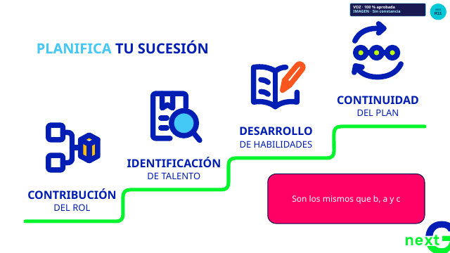

# Lámina 069 · ID PPT 259

## Trazabilidad

- XML de origen: `Sucesion_R11_Large_v10_Deduplicada_2026-11-17_0701_GT.xml` (versión 2; Flat OPC).
- SHA-256 del XML: `a31bc4260d3bf3c96678b66efd5bdf2fbc49dafac046904403b2f81e8c430f2d`.
- Procedencia de la miniatura: Exportada desde una copia con las láminas ocultas incluidas; el XML fuente no se alteró.
- Procedencia de la locución: Notas del XML; esta lámina no estaba en el TXT de las visibles.
- Posición física: **069**; ID nativo: **259**.
- Archivo de imagen: `Sucesion_R11_Large_v10_Deduplicada_2026-11-17_0701_GT__069.png` (640 × 360).
- SHA-256 del PNG: `02b64f0094f2af64f245e811553ee4f2fc969941bf543470136b9f19582a1259`.
- Estado: **oculta en el XML; marcado para eliminar**.

## Juicio de Sammy (no es veredicto de Randy)

- **Imagen:** 3/5 · La escalera verde lleva bien el ojo de un pictograma a otro; el post-it magenta distrae e interrumpe una cuadrícula ya ocupada.
- **Locución:** El recorrido de cuatro momentos sirve de brújula; no necesita explicar a fondo cada paso aquí.
- **Referencia alternativa:** [Lámina 007](../007/Sucesion_R11_Large_v10_Deduplicada_2026-11-17_0701_GT__007.png) · Ofrece las cuatro etapas en la secuencia visible sin el recuadro editorial.

## Voz en off

*Texto de las notas de una lámina oculta. No equivale a voz final aprobada.*

Te presentamos el programa NextGen. Consta de cuatro pasos que te ayudarán a planificar tu sucesión.

Comienza analizando las funciones de tu propio rol y actualiza el modelo de contribución al puesto que ya conoces.

Después, identifica en tu equipo al talento que podría prepararse para asumir ese rol, considerando interés y habilidades demostradas.

Analiza sus brechas y planifica experiencias que le permitan desarrollar esas habilidades necesarias.

Tu liderazgo también se refleja en cómo das continuidad al programa, acompañando el desarrollo y documentando la transformación profesional de tu sucesor.
