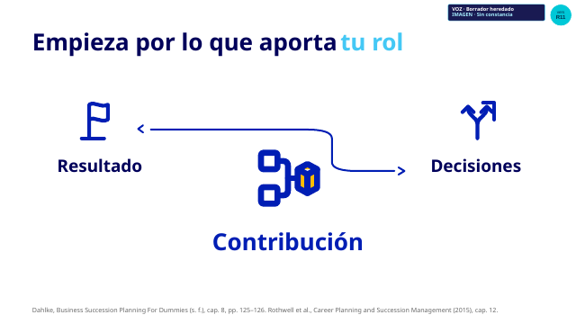

# Lámina 073 · ID PPT 262

## Trazabilidad

- XML de origen: `Sucesion_R11_Large_v10_Deduplicada_2026-11-17_0701_GT.xml` (versión 2; Flat OPC).
- SHA-256 del XML: `a31bc4260d3bf3c96678b66efd5bdf2fbc49dafac046904403b2f81e8c430f2d`.
- Procedencia de la miniatura: Exportada desde una copia con las láminas ocultas incluidas; el XML fuente no se alteró.
- Procedencia de la locución: Notas del XML; esta lámina no estaba en el TXT de las visibles.
- Posición física: **073**; ID nativo: **262**.
- Archivo de imagen: `Sucesion_R11_Large_v10_Deduplicada_2026-11-17_0701_GT__073.png` (640 × 360).
- SHA-256 del PNG: `1079b61b2eb07714b138674190e7143f709b1072e8e9208316271874ea8e8a24`.
- Estado: **oculta en el XML; marcado para eliminar**.

## Juicio de Sammy (no es veredicto de Randy)

- **Imagen:** 3/5 · La línea quebrada conecta tres símbolos, aunque la relación de izquierda a derecha es ambigua y la fuente al pie queda diminuta.
- **Locución:** Conviene decir resultado y decisión una sola vez, con un ejemplo de cómo se observan.
- **Referencia alternativa:** [Lámina 015](../015/Sucesion_R11_Large_v10_Deduplicada_2026-11-17_0701_GT__015.png) · Hace del criterio observable el propósito explícito de la pieza.

## Voz en off

*Sin locución publicable separada con certeza de las notas editoriales, o sin notas en el XML.*
