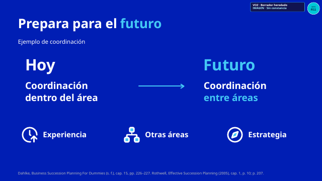

# Lámina 074 · ID PPT 263

## Trazabilidad

- XML de origen: `Sucesion_R11_Large_v10_Deduplicada_2026-11-17_0701_GT.xml` (versión 2; Flat OPC).
- SHA-256 del XML: `a31bc4260d3bf3c96678b66efd5bdf2fbc49dafac046904403b2f81e8c430f2d`.
- Procedencia de la miniatura: Exportada desde una copia con las láminas ocultas incluidas; el XML fuente no se alteró.
- Procedencia de la locución: Notas del XML; esta lámina no estaba en el TXT de las visibles.
- Posición física: **074**; ID nativo: **263**.
- Archivo de imagen: `Sucesion_R11_Large_v10_Deduplicada_2026-11-17_0701_GT__074.png` (640 × 360).
- SHA-256 del PNG: `c69b4201304a051c180ab7ef02007017e709482865ba3f7d26b43344430221fd`.
- Estado: **oculta en el XML; marcado para eliminar**.

## Juicio de Sammy (no es veredicto de Randy)

- **Imagen:** 3/5 · El eje Hoy–Futuro con flecha limpia se entiende rápido; la fila de tres iconos aún parece una plantilla genérica.
- **Locución:** Un solo contraste entre coordinación interna y transversal sostiene la idea sin repetir la lista inferior.
- **Referencia alternativa:** [Lámina 013](../013/Sucesion_R11_Large_v10_Deduplicada_2026-11-17_0701_GT__013.png) · Desarrolla el contraste entre presente y futuro en la secuencia visible.

## Voz en off

*Texto de las notas de una lámina oculta. No equivale a voz final aprobada.*

El puesto para el que preparas a un colaborador también puede cambiar. Una nueva tecnología, una necesidad distinta del cliente o una prioridad del negocio puede modificar las decisiones que tendrás que tomar. Al definir el rol, reúne lo que sigue siendo importante y lo que necesitará evolucionar.

En el equipo ficticio de operaciones, resolver una incidencia conocida puede exigir aplicar un procedimiento probado. Una situación nueva puede requerir comparar información contradictoria, consultar a especialistas y elegir una respuesta antes de tener todos los datos. El conocimiento técnico sigue siendo útil; la capacidad de coordinar y ajustar el criterio cobra mayor importancia.

Para construir esa mirada, combina tu experiencia con las necesidades de las áreas que dependen de tu trabajo y con la estrategia de la compañía. Conversa sobre los cambios que ya pueden reconocer y sobre las preguntas que todavía necesitan responder. Distingue una exigencia confirmada de una posibilidad que conviene seguir observando.

Después traduce esas necesidades a conductas. Si el rol exige adaptación, describe qué haría el colaborador: reconocer un cambio, buscar información, revisar una prioridad y explicar su decisión. Si requiere innovación, observa cómo identifica un problema, compara opciones y propone una prueba que pueda realizarse dentro de sus atribuciones.

Esta descripción te ayuda a preparar a alguien con su propia manera de contribuir. Puede comunicarse de otra forma o tener una experiencia distinta a la tuya y, aun así, tomar buenas decisiones. Lo importante es que pueda responder a las exigencias del trabajo y aprender cuando cambien.

En el formato de contribución, Hoy y Futuro deben hablar de la misma capacidad. Si hoy describes la coordinación de una entrega dentro de tu área, explica qué coordinación entre áreas podría requerirse después. Esa continuidad permite ver el aprendizaje que falta y evita comparar tareas que no tienen relación.

Revisa el perfil cuando aparezca un cambio relevante. Mantén lo que sigue siendo válido y actualiza la exigencia que cambió, junto con su motivo. Así el desarrollo conserva una dirección que responde al trabajo real.
