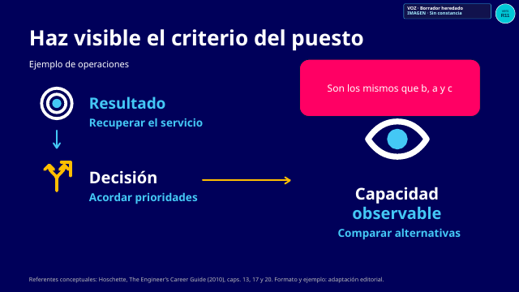

# Lámina 077 · ID PPT 264

## Trazabilidad

- XML de origen: `Sucesion_R11_Large_v10_Deduplicada_2026-11-17_0701_GT.xml` (versión 2; Flat OPC).
- SHA-256 del XML: `a31bc4260d3bf3c96678b66efd5bdf2fbc49dafac046904403b2f81e8c430f2d`.
- Procedencia de la miniatura: Exportada desde una copia con las láminas ocultas incluidas; el XML fuente no se alteró.
- Procedencia de la locución: Notas del XML; esta lámina no estaba en el TXT de las visibles.
- Posición física: **077**; ID nativo: **264**.
- Archivo de imagen: `Sucesion_R11_Large_v10_Deduplicada_2026-11-17_0701_GT__077.png` (640 × 360).
- SHA-256 del PNG: `59b3bf4b6cb9437c3864d018d6d0f7f1e215896254abf136f7ff4b40df117581`.
- Estado: **oculta en el XML; marcado para eliminar**.

## Juicio de Sammy (no es veredicto de Randy)

- **Imagen:** 2/5 · El diagrama reparte bien resultado y decisión, pero el recuadro fucsia de revisión compite con el ojo y corta la ruta.
- **Locución:** El ejemplo de recuperar el servicio hace observable el criterio; recortaría las reiteraciones antes de pasar a talento.
- **Referencia alternativa:** No encontré una alternativa mejor verificada.

## Voz en off

*Texto de las notas de una lámina oculta. No equivale a voz final aprobada.*

El formato de contribución del puesto reúne la referencia para los siguientes pasos. Úsalo para explicar el resultado que necesitas sostener, las decisiones que lo hacen posible y las capacidades que quieres observar en quien se prepara.

En el caso de operaciones, puedes comenzar con un resultado: recuperar el servicio coordinando la respuesta de las áreas involucradas. Después, precisa una decisión: acordar la prioridad de atención con la información disponible y reconocer cuándo hace falta otra autorización. La capacidad se vuelve observable cuando el colaborador compara alternativas, explica sus consecuencias y coordina un acuerdo que las áreas puedan cumplir.

Añade las relaciones y las condiciones necesarias. Para tomar esa decisión, el colaborador puede necesitar información de red, soporte y atención al cliente, acceso autorizado a los registros y un espacio para consultar a los responsables. Si esas condiciones faltan, tendrás que resolverlas antes de interpretar su actuación.

Esta referencia también te ayuda a acompañar. Puedes mostrar cómo analizas un caso, explicar por qué descartaste una opción y señalar una excepción que el procedimiento no desarrolla. El colaborador podrá hacer preguntas sobre una decisión concreta y reconocer qué necesita practicar.

Al revisar el formato, comprueba que un colaborador que conoce el trabajo pueda entender qué observarás. Expresiones como «tener liderazgo» o «pensar estratégicamente» necesitan una explicación aplicada al puesto. Describe la decisión, el contexto y la conducta que mostraría esa capacidad.

Con el rol definido, ya puedes conversar sobre talento con una base común. Tendrás una referencia para reconocer fortalezas, distinguir una experiencia pendiente y elegir oportunidades de desarrollo. Esa misma referencia permitirá revisar los avances más adelante, sin cambiar el criterio según el colaborador que estés considerando.
